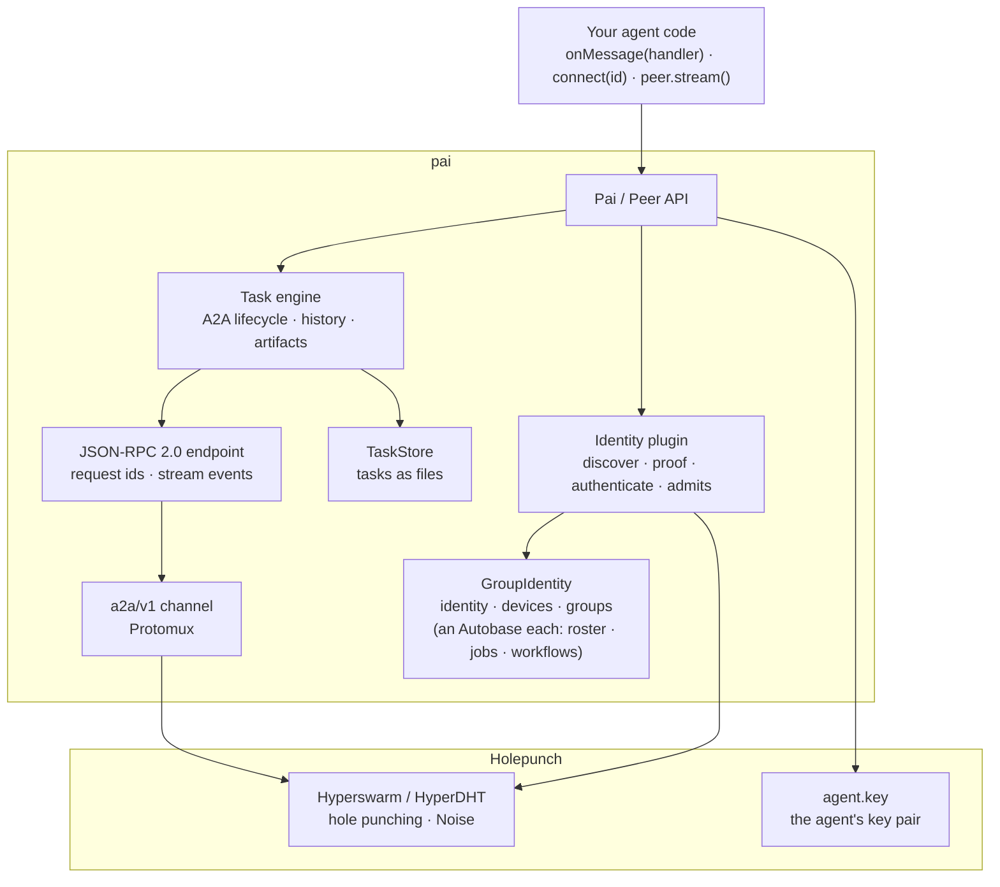
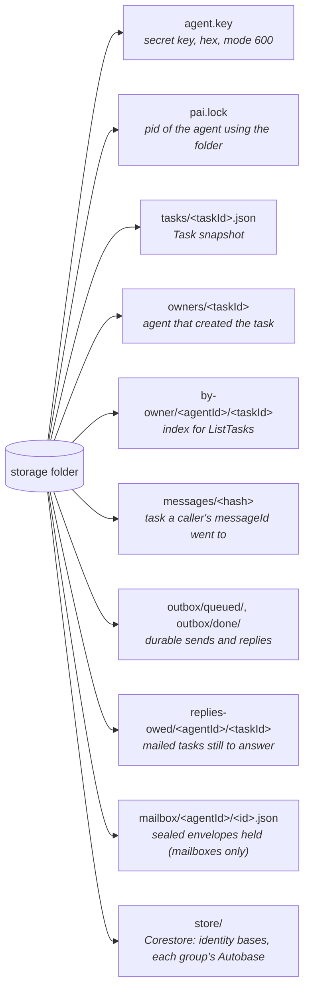
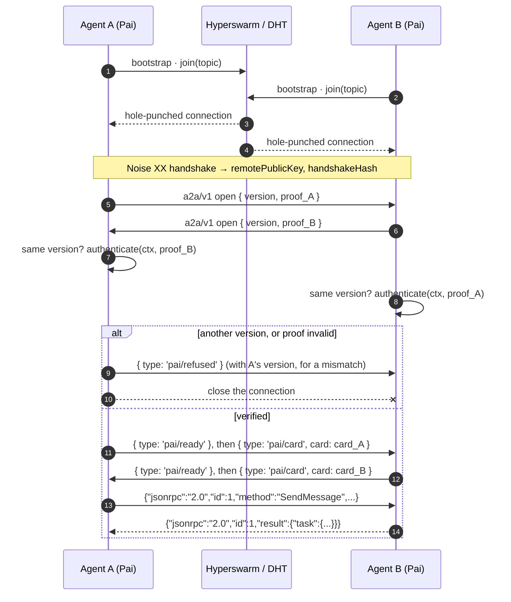
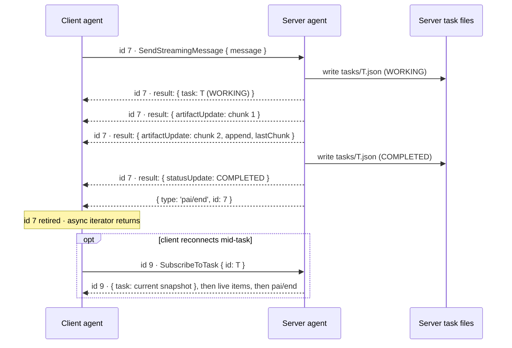
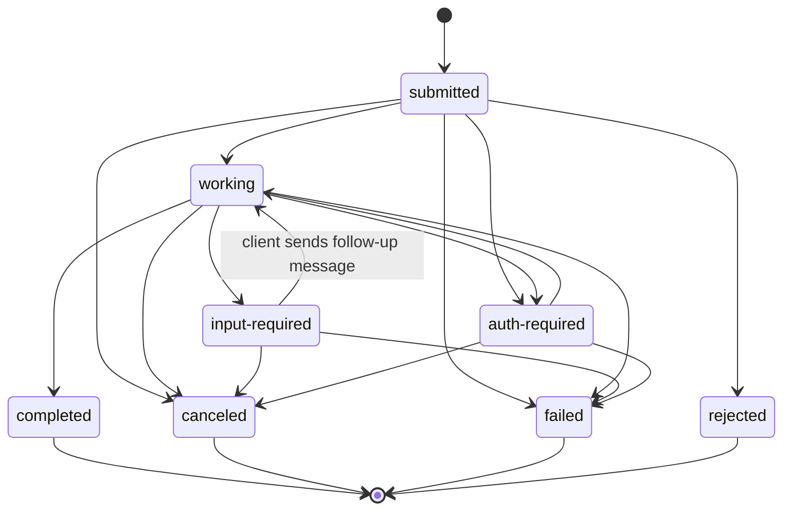
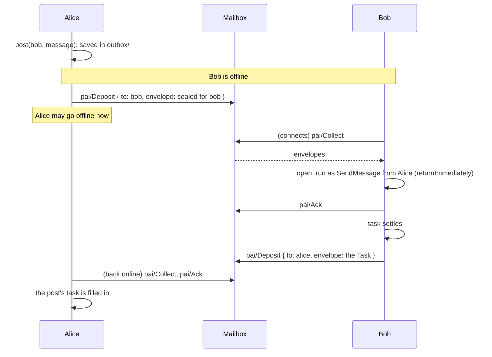

# pai design

`pai` is a TypeScript library that lets AI agents talk to each other using the
[A2A protocol](https://a2a-protocol.org/) (v1.0) over Holepunch peer-to-peer
networking. There are no public HTTP servers: agents find each other on Hyperswarm,
authenticate over Noise-encrypted connections, and exchange the same JSON-RPC
2.0 messages as A2A's JSON-RPC binding over a Protomux channel. A call
needs both agents online; a durable send can wait at a mailbox.

In A2A terms, pai is a **custom protocol binding**: the payloads are the
JSON-RPC binding's, and only the transport, framing and service-parameter
carriage differ. Cards list it in `supportedInterfaces` with
`protocolBinding: PAI_BINDING`, the URI of the binding's spec,
[BINDING.md](./BINDING.md) (`https://github.com/natzcam/pai/blob/main/BINDING.md`).

| Concern | A2A over HTTP | pai |
| --- | --- | --- |
| Discovery | `GET /.well-known/agent-card.json` | `pai/card` frame, pushed once connected and on each change |
| Transport | HTTPS POST | Protomux channel `a2a/v1` on a Hyperswarm connection |
| Envelope | JSON-RPC 2.0 | JSON-RPC 2.0 (byte-for-byte the same) |
| Service parameters | HTTP headers (`A2A-Version`, `A2A-Extensions`) | `a2a-service-parameters` object on each request |
| Streaming | Server-Sent Events, closed at the end | JSON-RPC responses sharing the request `id`, then a `pai/end` frame |
| Identity / auth | HTTP auth schemes | Noise public key + pluggable `Identity` |
| Task storage | server's choice | files in the agent's storage folder; each also in the log of the group it's shared in |

## Goals and non-goals

**Goals**

- A2A v1.0: `SendMessage`, `SendStreamingMessage`, `GetTask`, `ListTasks`,
  `CancelTask`, `SubscribeToTask`, with v1.0 data shapes, errors and
  version checks
- Identity: `GroupIdentity`, an identity with its devices, in any number
  of groups, each a roster kept by admins in a replicated log. The
  `Identity` interface stays pluggable.
- In each group: shared work (a job board, workflows), with people taking
  part
- Editable Agent Card that peers can read, and watch for changes
- Persistent tasks that survive restarts
- A command line and a local web page for running and calling agents
  without code
- Node.js, ESM only, TypeScript, Apache-2.0

**Non-goals**

- Store-and-forward without a mailbox: a message waits for an offline
  recipient only at a mailbox someone runs (see Offline delivery).
- A directory of agents.
- HTTP ⇄ P2P bridge, Bare / Pear runtime support
- Push notifications (the `*TaskPushNotificationConfig*` methods return
  `PushNotificationNotSupportedError`) and extended cards
  (`GetExtendedAgentCard` returns `ExtendedAgentCardNotConfiguredError`)
- A2A v0.3: requests without `A2A-Version: 1.0` are refused

## Architecture



Each authenticated Hyperswarm connection carries one Protomux channel,
`a2a/v1`: the handshake (protocol version and identity proof), the
`pai/ready` and `pai/card` frames, then JSON-RPC traffic, including the
mailbox methods and the identity's own (see Identities and devices). Each
connection also replicates the agent's store: the identity bases, and the
groups both sides are in.

## Versions

pai carries two versions, both 1:

- **The protocol** (`PAI_VERSION`, `src/protocol/channel.ts`): everything
  on a connection, as BINDING.md specifies. It's the first field of the
  channel handshake. Two agents on different versions refuse each other
  before checking proofs, and both say which versions they run
  (`pai/refused` carries the refuser's).
- **A group's rules** (`RULES`, `src/group/state.ts`): how the group's
  Autobase is folded into its state. It's in the group's own log (see
  Rules versions, under Groups), so a group moves to new rules at one
  point in the log that every replica agrees on.

The CLI's groups file (`.pai/groups.json`) is format `groups/1`.

## Data model: the agent's storage folder

The storage folder holds the agent's key pair (`agent.key`, so its id
survives restarts), a lock, and plain files for tasks and mail. None of these
files is replicated: peers see tasks through the A2A methods (and the copies
in group logs). It also has `store/`, the Corestore with this device's
identity base (namespace `identity`), replicas of its groups' members'
identity bases (`identity/<key>`), and each group's Autobase
(`group/<slot>`), which members replicate to each other (see Groups).



- **The card** lives in memory: `ready()` builds it from the options, and
  `updateCard()` replaces it and pushes it to every connected peer. Peers read
  it with `peer.card()`, or follow it with `peer.watchCard()`.
- **`supportedInterfaces`:** pai writes its own entry,
  `{ url: 'pai://<hex agent id>', protocolBinding: PAI_BINDING, protocolVersion: '1.0' }`.
  An entry with that binding is corrected in place; otherwise it goes first.
  Other interfaces (an HTTPS bridge, say) keep their order.
- **Tasks** are full `Task` snapshots, rewritten on every state change, each
  written to a temporary file and renamed into place. This makes `GetTask`
  work after a restart. Responses apply `historyLength` (`0` omits the
  history).
- **Ids are file names,** and task ids come from peers, so anything that isn't
  a plain id (letters, digits, `.`, `_`, `-`; not starting with `.`) is simply
  not found and never names a path outside the folder.
- **Task owners:** `owners/<taskId>` holds the hex id of the agent that
  created the task. It's kept outside the `Task`, which callers get exactly as
  A2A defines it. `by-owner/` indexes the same, for `ListTasks`. See Task
  ownership.
- **Retries:** `messages/` maps a caller's `messageId` (hashed, since it's
  the caller's string) to the task it started or continued, so a resent
  message gets the same task (BINDING.md, Section 3.4).
- **The key pair** is `agent.key`: the 64-byte Ed25519 secret key (seed,
  then public key) as hex, mode 600, made on first start
  (`src/store/key-file.ts`). It's checked on load: the public half must match
  the seed. Losing it means a new agent id. An app that keeps it elsewhere
  (the phone, in the OS's key store) passes it as `keyPair`, and then no
  `agent.key` is read or written.
- **One agent per folder:** `ready()` takes `pai.lock` (created exclusively,
  holding the pid) and `close()` releases it. A lock whose process is gone is
  taken over (`src/util/lock.ts`).

### Cards: validation and watching

- **Validation:** `validateCard(card)` checks the fields the v1.0 proto marks
  REQUIRED (`name`, `description`, `version`, `supportedInterfaces` with
  `url`, `protocolBinding` and `protocolVersion`, `capabilities`, the default
  modes, and each skill's `id`, `name`, `description` and `tags`; required
  arrays must be non-empty), plus the shape of the optional fields pai models
  (`provider`, `documentationUrl`, `iconUrl`, `capabilities.extensions`). It
  returns one message per problem. Unknown fields are allowed, as the spec
  asks.
- **Own card: strict.** `ready()` and `updateCard()` throw `PaiCardError`
  (with `errors` and the `card`) instead of writing an invalid card. `ready()`
  checks before it opens any storage.
- **Remote cards: strict by default.** `peer.card()` throws `PaiCardError` for
  an invalid card. `peer.card({ strict: false })` returns whatever was sent.
- **Pushing:** each side sends `{ type: 'pai/card', card }` right after its
  `pai/ready`, and again on every `updateCard()`. `Pai` keeps the latest card
  per remote agent id, across reconnects. `peer.card()` returns it, waiting
  (up to `timeout`) if none has arrived yet.
- **Watching:** `peer.watchCard({ signal, strict, onInvalid })` yields the
  current card, then each one pushed after it. In strict mode an invalid
  version is skipped and passed to `onInvalid`, so one bad edit doesn't end a
  long-running watch. A dropped connection doesn't end it: it resumes with
  the card pushed on reconnect. It ends when `signal` aborts, the loop breaks,
  or the watching agent closes.

## Identity

Identity is a plugin. `Pai` never decides on its own who to trust.

```ts
interface Identity {
  discover (swarm, self): Promise<void>                // join topics
  proof (ctx): Uint8Array                              // sent in channel handshake
  authenticate (ctx, remoteProof): Promise<boolean>    // false → drop
  resolve (id): Promise<AgentRecord | null>            // id → { id, name? }
  remember? (record): void                             // told about authenticated peers
  bootstrap? (): BootstrapNode[]                       // extra DHT bootstrap nodes
  refresh? (self): Promise<void>                       // told when the card changes
  attach? (conn, remoteId): void                       // proof checked: e.g. replicate over conn
  admits? (id): boolean | 'pending'                    // may it call? absent → yes
  onAdmissionChange? (listener): () => void            // admits() may have changed
  principalOf? (device): string | null                 // the identity a device acts for
  isPrincipal? (id): boolean                           // an identity, not a device?
  mayCall? (caller): boolean                           // does policy let it call this agent?
  tasks? (): SharedTasks | null                        // tasks shared in groups
  serves? (method): boolean                            // a JSON-RPC method it answers itself
  serve? (method, params, device): Promise<unknown>
  connected? (peer): void                              // both sides accepted the connection
  close? (): Promise<void>
}
```

`authenticate` says whether a peer may be on the connection at all;
`admits` says whether it may make calls. Pai holds a `'pending'` peer (its
calls wait, and it's sent `pai/waiting`), refuses a `false` one, and on each
admission change drops any peer it had accepted that is no longer admitted.

A connection's **agent id** is the Noise (Hyperswarm) public key of the
device. Noise already proves that the remote side holds the secret key for
it, so plugins only need to decide whether that key is allowed in. In a
group, a device acts for an **identity** (see Groups), which is the caller
for task ownership and policy.

## Groups

A group is a roster, policy, a job board and workflows, kept in one
[Autobase](https://github.com/holepunchto/autobase) (7.x) that every member
replicates (`src/group/`; wire format in BINDING.md, Section 4.2). Admins
change the group; members write their own ops and work items; every agent
enforces the same state. Nothing is central: there's no server, and any
member can be offline. Execution stays A2A: the base coordinates, while
messages and results go over the `a2a/v1` channel.

An identity can be in up to 32 groups (counting any it can't open: see
below). `GroupIdentity`
(`src/identity/group.ts`) holds the identity and its devices, and one
`GroupMembership` (`src/group/membership.ts`) per group: its base, seed
epochs, topics, admission, job board, workflows and the tasks shared in
it. Groups don't see each other: each has its own roster, policy, board
and tasks, and a group's members learn nothing of the identity's other
groups beyond how many it's in (the proof has one entry per group). A
group that won't open at start (this identity was removed from it, its
membership lapsed, or it moved to rules this build doesn't apply) doesn't
stop the others: it's kept, with its keys, and `problem` and `unopened()`
say why.

### Keys, writers and the view

- **Keys:** a group is the Autobase's key plus a random 32-byte seed
  (a `GroupEntry`, with this identity's local name for the group and its
  slot; the CLI keeps them in `.pai/groups.json`, mode 600). HKDF-SHA256
  over the seed (salt `pai/group/v1`) derives the discovery `topic`, the
  proof key `auth`, the Autobase's encryption key (so whoever has only the
  group's key can't read it) and the group's `id` (8 bytes, hex: what tasks
  and requests name it by, known only to members).
- **Admins** are writers and **indexers**: a majority of them must be
  online to advance `signedLength`, the point after which the log's order
  is final. Run 3 or 5 admins, not 2 (with 2, either one being offline
  stalls signing).
- **Members** are writers but not indexers. `apply` checks every op
  against its author's standing *at that point in the linearized order*
  and skips (never throws on) one that breaks a rule, so one bad op can't
  stall the base for anyone.
- **The view** (`src/group/state.ts`, a Hyperbee): `meta` (with the
  group's own name, `title`, from `init`), `admin/<id>`,
  `member/<id>`, `writer/<key>` (writer → identity), `removed/<id>`,
  `invite/<id>`, `proposal/<pid>`, `quorum`, `policy/<name>`, `epoch` and
  `seed/<epoch>/<device>`, `clock`, `rules`, `task/<identity>/<id>`, and
  the job board's and workflows' keys (see Job board, Workflows).
- **Removals act on the latest view; additions and job claims act on the
  signed one.** Acting on a removal before it's final fails closed (the
  worst case is a brief, wrong refusal if it's reordered away). Acting on
  an addition or a claim before it's signed could be undone by a reorder,
  so admission and starting a job wait for the signed view.
- **Signing latency:** indexers ack on Autobase's timer (every 1 to 2 s),
  but one that applies a `job.claim` acks 25 ms later (so claims landing
  together share an ack), at most once per 100 ms (so replaying a long log
  or a flood of claims can't make it ack nonstop), and once more if the
  view is still unsigned after. On a testnet a claim is signed in about
  40 ms, and a workflow's steps cost about 100 ms each beyond their work
  when they follow each other at once. Admissions and other ops wait for
  the timer.

### Admins and proposals

Any single admin adds, renews and removes members, sets roles and policy,
and makes invites. The admin set, the quorum, the seed and the rules
version need `k` of the `n` current admins: one proposes, others approve
(`propose`, `approve`, `withdraw`), and `apply` runs the op once `k`
distinct current admins back it, within 7 days of the proposal. `k` is a
majority (1 of 1, 2 of 2, 2 of 3, 3 of 5) unless `quorum.set` fixes it.
The last admin can't be removed. A compromised admin can remove members,
but can't remove the other admins or take the group over. Conflicting
proposals (two that each remove the other's author) resolve by the log's
order: once one passes, approvals from the admin it removed no longer
count.

### Joining

`pai group invite` makes a [blind-pairing](https://github.com/holepunchto/blind-pairing)
invite and records its public key in the base (`invite.add`, with roles
and an expiry). The code is the invite, then a dot and the group's
`title`, both base64url: the joiner's name for the group defaults to it.
`pai group join <code>` (`joinGroup()`, or `GroupIdentity.joinGroup()` on
a running agent) sends the identity, the device's key and its writer,
signed with its agent key, so nobody joins under another's id; an online
admin checks the invite, appends `member.add` (which uses the invite up)
and answers with the group's key and seed. Only admins answer, so a join
waits for one to be online. The pairing runs on a swarm of its own, with
a key of its own: the device's running agent would refuse the admin's
connection, from a group it isn't in yet.

Each group lives in a slot of the agent's store (`group/<slot>`, a random
local name made at create or join). Writer keys come from the namespace,
so the joining writer is known, and sent, before the group's key is.

### Admission

The handshake proof is the identity the device acts for (32 bytes), an
HMAC with the identity's own `auth` key (from its secret: see Identities
and devices), then one 68-byte entry per group: the epoch, an HMAC with
that epoch's `auth` key and one with epoch 0's. Every HMAC covers the
handshake hash, the device key and the identity. The receiver tries each
entry against each of its groups; it accepts the connection if the
identity's MAC holds (another device of its own identity) or an entry
holds for a group both are in, and refuses it if an entry for one of its
groups holds for epoch 0 but not for an epoch it knows. A device that
claims this identity must have the identity's MAC.

A valid proof lets the peer replicate (`attach`); calls need it to be
**admitted**. Another device of this identity is admitted once this
identity's base lists it. Any other is admitted if some group it proved
admits it: its identity an admin, or a member whose `until` hasn't
passed, in both the latest view and the signed one, and the device listed
in the identity's own base. So a removal counts as soon as it's seen, an
addition once it's signed. Unknown or unsigned → `'pending'` (its messages
are dropped and only its latest card is kept, so an unknown seed holder
can't make the agent buffer anything); removed or lapsed in every group
it proved → refused. `GroupBase` re-reads the roster on every update and
emits `change`, and every 30 s besides (memberships lapse with time); Pai
re-checks every connection on each.

### Identities and devices

An agent is an **identity** that runs on one or more **devices**
(failover, a laptop and a server, a phone), so a lost device can be cut
off without changing the agent's id (`src/devices/`). The identity is the
same in every group it's in, and so are its devices.

- **The identity** is its own Autobase: its key is the identity's id, the
  A2A principal (the caller for task ownership and policy, the id in `pai
  send <id>`, every roster's member id). Its view lists `device/<noise
  key>` and `removed/<noise key>`, and holds the identity's `card`, so
  every device publishes the same one. With it goes a 32-byte **secret**
  every device holds (`IdentityKeys`): HKDF-SHA256 over it (salt
  `pai/identity/v1`) gives the `auth` key for the identity's MAC in the
  proof, and a `topic` the devices join, so they find and recognize each
  other before they share any group.
- **Devices:** each keeps its own `agent.key` (its Noise key, for
  connections) and its own writers. Any single device adds or removes
  devices and edits the card, with no quorum, so device checks use the
  identity's latest view only and never wait for a majority of devices.
  `pai device invite` / `pai init --device <code>` (`joinDevice()`) adds
  one by blind pairing: the new device sends its key and its writer in the
  identity's base, signed; the inviting device appends `device.add` and
  answers with the identity's key and secret. `pai device remove <key>`
  takes one out (the last can't be).
  A device can also leave by itself (`GroupIdentity.leave()`, the phone's
  "leave"): it appends its own removal and waits until the block holding
  it has gone out to another device. Not until it's signed: applying its
  own removal retires its writer, and the other device stops talking to it
  as soon as it applies it, so a signature would never come back. A
  session it holds on its writer core keeps that core replicating until
  then.
- **Signers:** the identity's own devices are its base's indexers, so
  the identity belongs to no group and serves all of them. The creating
  device signs from the start; a device added later joins as a writer and
  signs once it has written (`device.hello`, appended when it first can),
  since Autobase stalls on indexers that never write. A removed device's
  writer stops signing as soon as Autobase allows (it keeps the last
  indexer until another device has said hello). Device checks use the
  latest view, so nothing waits for signing; with two devices, the log
  becomes final only while both are online.
- **In each group:** each device writes to the group with its own writer
  (`writer.add` names the device); when a device leaves its identity, a
  remaining device retires that writer (`writer.remove`). An admin device's
  writer signs the group once it has written (`hello`).
- **Groups across devices:** an identity's devices tell each other their
  groups, over the channel, with three methods only another device of the
  identity may call: `pai/Groups` (the caller's groups: name, key and
  seed), `pai/GroupsChanged` (look again) and `pai/AddWriters` (let these
  writers of the caller's into these groups: `writer.add`, and the current
  seed sealed to it). A device asks each of its own devices for their
  groups when it connects to them and when told they changed; it opens
  each group it lacks in a new slot, under the other device's name for it,
  and asks for its writers to be let into every group it can't write to
  yet, again every few seconds until it can (a group a device just joined
  may not list it as a member there yet). So a device added once ends up
  in every group, including groups joined later, while one of the
  identity's devices that is in them runs. The new list goes to
  `GroupIdentityOptions.onGroups`, to keep.
- **Connecting:** devices join each group's topic and the identity's own,
  so `connect(identity)` reaches whichever device answers first.
- **Tasks across devices:** task ids are `<16 hex of the device>.<uuid>`,
  so a request naming a task goes to the device that has it; ownership is
  by identity, so any device of the caller's identity can continue or
  cancel a task its identity created.
- **Limits:** device invites live in the inviting daemon's memory; a
  device addition can be undone if a reorder puts it behind a concurrent
  removal of the device that added it (every replica converges on the
  same order); a removed device can serve a stale copy of its identity
  base, which a peer that has heard from no other device believes until it
  does.

### Roles and policy

- **Roles** are free-form names (`[a-z][a-z0-9_-]*`, up to 8 per member,
  `admin` reserved), set by any admin (`member.roles`) or given by an
  invite. Jobs and policy use them.
- **Policy:** rules `{ name, from, to, allow }` (`policy.set`,
  `policy.remove`, any admin; at most 256). Selectors are `*`,
  `role:<r>` or an identity; admins also match `role:admin`. Of the rules
  matching both sides, the one naming the caller most specifically wins,
  then the callee; a deny wins a tie; no matching rule allows. Each agent
  enforces it for calls to itself (`Identity.mayCall`), on requests and
  on mail, with reason `NOT_ALLOWED_BY_POLICY`; its own identity's devices
  are always allowed. A direct call carries no group, so it's allowed if
  the policy of any group both are in allows it; a job (or step) is
  judged by its own group's.
- **Posting is calling:** a job (or a workflow's step) asks whoever takes
  it to run it as the poster, so the same rules decide what a member may
  post: for an identity, the rules on calling it; for `role:<r>`, the
  rules naming that role or `*`; for anyone, the rules naming `*`; for the
  poster's own identity, always. `apply` skips a post the rules refuse,
  and checks each workflow step again as it's posted.

### Seed epochs

A removed member keeps the seed it had. `seed.rotate` (k of n) gives the
group a new one: the proposing admin seals it to every device the roster
records for a current member, as libsodium sealed boxes to the devices'
Noise keys, with a commitment to the seed (`check`). When it passes, the
rules keep only boxes for devices of identities still members then.
Devices without a box get one (`seed.share`, matching the epoch's `check`,
never over an existing box): from their own identity's other devices at
once, from the admin that admits a new member or device, and from any
admin once a box has been missing for 20–40 s (so admins don't all write
the same one). A device re-opens its box whenever it changes, and only
takes a seed matching the commitment, so a reordering that swaps one
rotation for another can't leave it on the losing seed. The topic and the
proof key follow the epoch; the Autobase's encryption key can't change,
so it stays with epoch 0's seed.

- **Standing:** a MAC for the latest epoch the receiver knows is enough;
  anything else needs the epoch-0 MAC plus the receiver's roster vouching
  for the device (a current member's device, on record, not removed). That
  shuts out removed members, who still hold epoch 0's seed. A device whose
  roster is empty (just joined) can't vouch, so it lets peers sync while
  it loads the roster and re-checks them after: in that moment, a removed
  member that finds the new device can sync what it has so far.
- **Discovery:** admins announce on epoch 0's topic as well as the current
  one, and every device looks there, so a device that missed a rotation,
  or a new one (blind pairing hands over epoch 0's seed), finds the group.
- **Limits:** a rotation doesn't make anyone forget what they synced.

### The group's clock

An op's time (`at`) is its author's word, so a member could date a claim
ahead to take a lease that hasn't run out, or backdate an op past its
membership's end. The group keeps a clock instead: the latest time any
admin's op carries (admins are trusted: they sign the log). Leases, job
limits, memberships and invites run out by it, and an op counts as made no
earlier than it. A claim's lease starts no later than a lease past the
clock, so a claim dated far ahead can't hold a job for good. Nothing moves
the clock while admins are quiet, so an admin's device appends
`clock.tick` when something falls due by its own clock (after up to a
second, so several admin devices seldom all do). Admins are online for
signing anyway.

- **Limits:** an admin's clock far ahead makes leases and memberships
  lapse early for everyone; a worker more than about two thirds of a lease
  behind the admins misses its renewals and loses leased jobs. Keep clocks
  in sync.

### Rules versions

The group's state is a function of its log and of the rules that fold it.
The version of those rules is in the log: `init` records the version a
group starts on (`rules`), and a `rules.set` quorum op moves it forward.
A change to what an op does is gated on the group's version, so every
replica switches at the same op. A build that meets a version newer than
it applies calls Autobase's `host.interrupt` at that op: the base stops
there, with nothing of the op applied, and the agent says to upgrade
(`GroupIdentity.problem`, the daemon's log, `pai group rules`). Once
upgraded, it applies the same op and carries on. Admins move a group on
(`pai group rules <v>`) once every member's pai applies the version; the
gateway refuses one the admin's own pai doesn't.

A change that skips that gate (two builds folding the same op
differently at one version) splits replicas without an error: a replica
that doesn't index takes the indexers' signatures only for a state it
computed the same way, and Autobase drops the failed signing silently,
so its signed state stops moving. Each replica (`Replica.checkSigning`)
watches for that when it doesn't index: its signed length below the
indexers' and not moving for a minute. It then adopts their signed state
(a forced fast-forward) and applies its own unsigned ops on from there,
at most every 5 minutes. The repair is what catches it up, so stalling
again within half an hour of one is what shows the build really differs;
the agent then says so (`problem`, the daemon's log: run the same pai
version as the admins) until half an hour passes with no repair.

### Shared tasks

Each task is shared in one group: the agent writes its state to that
group (`task.put`, by the serving identity only), so every member's
replica there has it.

- **Placement:** decided when the task is made, and kept in its metadata
  as `pai/group` (the group's id). A job's task goes in the job's group
  (the worker's message names it). A direct call's goes in the group the
  message names (`pai/group` in its metadata: the daemon's gateway fills
  in `?group=` or the default group), if both sides are in it; else in the
  first group both are in, by id; else nowhere (it stays on the device).
- **Reads:** a member of a task's group can `GetTask` it, and `ListTasks`
  lists the tasks a caller may read (its own, and those of the groups it's
  in); anyone else gets `TaskNotFound`. A caller answers from its own
  replicas when no device of the agent is connected, and `ListTasks`
  merges live devices with them.
- **Control:** continuing or canceling a task takes its creator or an
  admin of its group; anyone else gets `NOT_TASK_OWNER`.
- **Records** are keyed `task/<serving identity>/<task id>`, so nobody can
  claim another's task id, and the newer snapshot (by status timestamp)
  wins whatever order two devices' writes land in.
- **Devices:** any device of the serving identity can take up a task
  that's waiting or finished (`SharedTaskStore` reads the newer of its file
  and the group's copy, and never lets a cut-down copy replace a whole
  one); a running task stays with its device, which has the runner.
- **Cost:** writes are batched per task (a new state within 250 ms, a
  final one at once, streaming updates at most every 5 s). A task over 256
  KiB is stored without its artifacts, then with its history trimmed, then
  as just its state.

### Limits

- Revocation is as fast as replication: a member that hasn't synced still
  accepts a removed agent. `until` is the backstop.
- With a majority of admins offline, nothing becomes final: members still
  see new ops, but additions and job claims don't become signed, so no
  work starts.

## Job board

Work any member posts to the group, and whichever member may claim it runs
it (`src/group/jobs.ts`, `src/jobs/worker.ts`). The board records who does
what and how it ended; the work itself is an ordinary A2A task.

### Ops

| Op | Who | Effect |
| --- | --- | --- |
| `job.post {id, spec, to, lease, timeout?, deadline?, retries?, backoff?}` | a member the policy lets post for `to` | `job/<id>`, open. `spec`: text plus optional data, `attach` and `context` (16 KiB as JSON; see Context); `to`: `role:<r>`, an identity, or anyone |
| `job.claim {id, hand?}` | a member `to` allows | the first claim in the log's order wins; a later one only once the lease has run out by the group's clock; `hand`: a person's |
| `job.renew {id}` | the claiming device | the lease runs from then: forward only, at most two leases past the last, and not once it has run out |
| `job.release {id}` | the claimant | open again; the attempt doesn't count |
| `job.done {id, state, result, ref}` | the claiming device | `done` or `failed`; `result` inline up to 16 KiB, `ref` the task on the worker |
| `job.ask {id, n, text}`, `job.answer {id, n, text}` | the claiming device; the poster or an admin | a question from the run, and its answer (see People in the loop) |
| `job.cancel {id}` | the poster or an admin | while open or claimed |

### Workers

`JobWorker` (`pai daemon --worker`) claims the oldest open jobs it may (one
at a time by default: `concurrency`), starts one only once its claim is in
the signed view, and runs it through the agent's own handler (or, with
`--proxy`, the upstream) as a message from the poster, with message id
`job-<id>-<claim time>`. So the poster can read or cancel the task like any
of its own, and after a restart the same claim's message gets the task it
started (failed by recovery) instead of running twice, while a new claim
runs it afresh. A worker takes a job only if the poster is still a member
and the group's policy lets the poster call it. Results: the artifacts'
text, joined as streamed, inline up to 16 KiB, and `ref`, the task id
(shared with the group, so `pai task get <worker> <ref>` reads it all). A
worker that loses its claim (reordered away, lease taken over, timed out,
canceled) cancels the task; one that closes cancels its tasks and releases
its jobs.

### Context

A worker sees only the job's message: no transcript or shared memory
crosses between agents, and each keeps its own model context. What a job
carries is explicit:

- **Text and data:** up to 16 KiB as JSON, since every member keeps every
  op.
- **Attachments:** `spec.attach` names up to 8 ended jobs (done or
  failed; the poster's daemon checks). The worker (or `pai job take`)
  reads each one's whole result from the task its worker shared with the
  group (`ref`), and sends it as a text part headed `--- Attached: the
  result of <job or step> ---` (a failed one's starts `(it failed)`), with
  metadata `pai/attached`. If that task isn't there whole (a shared task
  over 256K characters keeps no artifacts), the board's copy stands in,
  saying where the rest is. A workflow step whose attached step has been
  pruned from the board gets the workflow's copy; anything else that
  can't be read gets a note saying why, never an error.
- **A context:** `spec.context` (1 to 64 of `A-Za-z0-9._:-`) runs the job's
  task in A2A context `<poster>:<context>` on whichever worker takes it,
  so a handler that keeps a conversation per context (a harness, or an
  exec command reading `PAI_CONTEXT_ID`) continues it. Every agent's server keeps a
  context of that shape (64 hex digits, then `:`) to the caller it names,
  for direct sends too, so no one joins another's context. Without it,
  each task gets a context of its own.
- **Another attempt:** when `lastError` is set on attempt 2 or later, the
  message ends (after any attachments) with a text part `(This is attempt n of m. The last attempt
  was lost: <why>)`, marked `pai/retry`, and the metadata carries
  `pai/attempt` and `pai/last-error`.

### Leases

At least 5 s. A worker renews its claim three times per lease from the
moment it claims (signing can take a while) until it reports. Only a
claimant that has gone quiet loses its job. Leases run out by the group's
clock, so an admin needs to be online for a job to change hands, as for
any claim to be signed. Every renewal is an op every member keeps: leases
of minutes, not seconds, for long jobs.

### Limits: timeouts, deadlines, retries

A job (or workflow step) may set `timeout` (ms an attempt may run, from its
claim's start), `deadline` (ms after posting by which it must end),
`retries` (0 to 20) and `backoff` (ms before the next attempt, doubling
each time, up to an hour).

- **Attempts:** each claim counts one (`attempt`). With `retries` set, a
  failure, a timeout, or a lease taken over after lapsing uses one up: the
  job opens again (after its backoff: `notBefore`, which claims respect,
  with `lastError` saying why, which the next attempt is told) until none
  are left, then fails. Without `retries`, a failure ends the job, and
  lapsed leases are taken over (also noting `lastError`) until the job has
  had 5 claims (`MAX_LAPSES`); the next takeover fails it, so a job that
  crashes or hangs each worker doesn't go round them for good.
- **When:** by the group's clock. The view keeps what falls due by time
  (`jobs-due/<time>/<id>/<kind>`, filed at the first moment it's past);
  whenever an admin's op moves the clock on, `apply` sweeps what's past
  (64 at a time), checking each is still true. Admin devices tick the
  clock for these as for leases, and again while anything past is left.
- This bounds what people leave waiting: a question no one answers, or a
  job taken by hand and forgotten, ends with its attempt. (A worker also
  gives up on a question by itself: see People in the loop.)

### Indexes and pruning

Open and claimed jobs are indexed by state (`jobs/<state>/<id>`), so
workers read only what's in play, from one snapshot. Ended jobs are indexed
in the order they ended in the log; past 1000, any job op prunes the first
to end (up to 16 at a time). Pruning goes by the log's order, never by an
op's own time.

## People in the loop

A person takes part in jobs in two ways.

- **Questions.** A run whose task stops in `input-required` asks on the
  board: its worker appends `job.ask` (the next `n`, once the last question
  is answered) and the job shows the question. The poster, or an admin,
  answers (`job.answer`, once), and the worker sends the answer to the same
  task as the poster's next message (id `job-<id>-<claim time>-answer-<n>`,
  so sending it again after a restart is harmless). A task can ask again,
  up to 100 times per claim. While it waits, the job doesn't count against
  the worker's concurrency (up to `maxWaiting` such jobs, default 8), and
  its lease is renewed as usual; once answered, the run resumes in the next
  free slot, ahead of new jobs. A question unanswered for `answerWithin`
  after it was asked (default a day; `pai daemon --worker --answer-within
  <s>`) cancels the task and fails the attempt ("No answer within …"),
  so questions nobody answers can't fill the waiting slots; retries, if
  any, ask again. If the board drops a question (the worker's
  membership lapsed, say), the run fails rather than ask again. A new claim
  starts without the question. `pai job post|get --wait` shows each
  question as it comes.
- **By hand.** A person is a member with a role whose daemon runs no
  worker for it. `pai job take` claims a job (marked `hand`, and known by
  its own time) and waits until that claim is signed, giving the job back
  if it isn't in time; `pai job done|fail <id> <text>` reports it, `pai job
  release` gives it back. Workers leave a hand claim alone, and only a hand
  claim made through this device can be finished or released this way. The
  person's daemon renews a leased job's claim while it runs, including
  after a restart.
- **Inbox:** `pai inbox` (`/pai/inbox`) lists questions on the agent's
  jobs (any job's, for an admin), open jobs it may take, jobs it holds by
  hand, and proposals an admin hasn't approved.
- **Limits:** no notifications beyond the inbox and the web page.

## Workflows

A workflow is up to 32 steps (`src/group/flows.ts`), each a job spec: `to`,
a text template, and optionally `lease` and the job limits; or a
sub-workflow. `after` names earlier steps it waits for, so the steps form
no cycles (a repeat runs them again as a new round instead). Templates use
`{{input}}`, `{{steps.<name>}}` (a step it waits for) and
`{{prev.<name>}}` (a step's result in the last round of the repeat both
are in).

- **Who drives it:** the group's rules, not a member. `flow.start` records
  the workflow (`flow/<id>`) and posts the steps that are ready; whenever a
  job ends, `apply` moves its workflow on. Being part of `apply`, it's
  deterministic, needs nobody online, and every replica agrees.
- **Posting steps:** a ready step's text is filled in from the results and
  posted as the starter's job, in context `flow-<id>` (see Context). A
  result goes inline if it fits. One its worker had to cut, and then the
  biggest while the text is over 16 KiB, are attached instead: the text
  says `[the result of step <name>: attached]` and the worker gets it
  whole. Text still too big is cut, says so, and the step is listed in
  `cut`. Each job is posted with an id derived from the
  workflow and step, so every replica posts the same one, with the top bit
  of its first byte set: `job.post` takes only ids with it clear, so no
  member can post a job under a step's id first. The policy is checked as each step is posted, and a step
  it refuses fails the workflow; so does the starter leaving the group.
- **Branches:** a step's `if { step, equals | contains | failed, not? }`
  tests a step it waits for: that step's result equals or contains the text
  (trimmed, ASCII case folded, so every replica agrees), or that step
  failed. A step whose steps are all settled (done, skipped, or failed on a
  branch) runs if its test holds, or, without one, if any step it waits for
  is done (or it waits for none), and is skipped otherwise. So a step behind
  a branch not taken is skipped, and a step after two branches runs after
  whichever ran. A test holds (either way) only for a step that ran. One
  pass in order settles every skip, since a step waits only for earlier
  ones.
- **Map steps:** `map: "input" | "steps.<name>"` (a step it waits for,
  and done: over one that failed on a branch the step is skipped) runs the
  step once per item, all posted at once. Items: the elements of a JSON
  array (non-strings as JSON), as the whole text or from its first `[` to
  its last `]` (a reply in a code block counts), or else its lines without
  list markers; blank ones are left out, and more than 32 fail the
  workflow. The text must use `{{item}}`. Each item is a job `<step>#<i>`
  (`job.flow.item`), with its id derived like a step's, in a context of
  its own (so items stay independent, and can run side by side on one
  worker). Results wait in `flow-item/<id>/<step>/<i>`; when all are done,
  the step's result is their JSON array, in order (`items` counts them),
  and the items' copies go. Attaching a map step attaches each item's
  whole result. No items: done at once with `[]`. An item that fails or is
  canceled fails the step (a branch, if a step tests for it) and cancels
  the other items.
- **Copies and settling:** `copies: n` (2 to 8) posts the same step n
  times as items (`{{item}}` the copy's number), each in a context of its
  own. A map or copies step's `settle` says when it ends: `all` (the
  default: as above), `first` (the first item done is the result; the rest
  are canceled; it fails once every item has), or `{ agree: k }` (once k
  results fold alike, as conditions compare them, the first of them is
  the result; the rest are canceled; it fails once k can't, counting the
  items left). Under `first` and `agree` an item's failure is a vote lost,
  not the step's; a canceled item still cancels the step.
- **Repeats:** `repeat { from, until, max }` on a step makes the steps from
  `from` through it a loop. Once they're all settled, if `until` (a test,
  as `if`, of one of them) holds or that was round `max` (2 to 10), the
  loop is over (`loops/<last step>.over`); else each of its steps' result
  moves to `flow-prev/<id>/<step>` and the steps start over as round n+1.
  A step's key in round n is `<step>@<n>`, and its job ids derive from that,
  so a late report from an earlier round matches nothing. Steps outside the
  loop count a step in it as settled only once the loop is over. A
  failure that `until` tests for (`failed: true`, either way) is a branch,
  not the end. Loops don't overlap; checking a workflow catches that.
- **Sub-workflows:** a step with `flow` (and no `to`, lease, limits, map,
  copies or settle) starts a workflow instead of posting a job: the one
  given, or the one a step it waits for wrote (`"steps.<name>"`: JSON, as
  the whole result or from its first `{` to its last `}`, or a bare array
  of steps). It's checked when it would start; one that isn't valid fails
  the step. Its id derives from the step's key as a job's would, with
  `parent { id, step }` and `depth` (at most 3), and the step's text,
  filled in, is its input. It's run by the same rules as any workflow, as
  the same starter; when it ends, the parent's step is done with its
  output, or lost as it was. Stopping a workflow stops its running
  sub-workflows, and its jobs, with it.
- **Failures:** a failure that some step runs on (`failed: true`, not
  `not`) is recorded in `failed` and takes that branch; any other failure,
  or a cancel, stops the workflow and cancels its open steps.
- **The end:** the workflow is done once every step is settled. Its
  `output` is the result of the final steps that ran (those no step that
  ran waits for): one alone as it is, several each under its name.
- **Storage:** the record keeps the spec and progress; each result is its
  own key (`flow-result/<id>/<step>`), and lists carry only summaries. The
  group keeps the last 1000 ended workflows, pruned in the order they
  ended.
- **Schedules:** `schedule.set {schedule: {name, flow, input, every,
  start?}}` keeps `schedule/<name>` (up to 64; one name again replaces
  it, another member's only by an admin; `schedule.drop {name}` by its
  setter or an admin). Its runs are due by the group's clock: from
  `start` (default a period after it's set), every `every` ms (1 minute
  to 366 days), each an entry in `jobs-due` that the clock's sweep
  picks up as it moves past. A run starts the workflow as its setter's
  with an id derived from the schedule and its run count, unless the last
  run is still going; either way the next is the first after the clock,
  so a clock that jumps past several makes one. A setter no longer a
  member drops the schedule at its next run. Since only admins move the
  clock, an admin's device has to be online for runs to start on time.
- **Ops:** `flow.start {id, name?, input, steps}` by any member, with an
  id whose top bit is clear (ids with it set are the rules' own, for
  sub-workflows and scheduled runs), `flow.cancel {id}` by the starter or
  an admin, and the schedule ops above. The policy is checked for every
  step's `to`, sub-workflows' written in place too, at the start and at
  `schedule.set`, and again as each step is posted. CLI `pai flow
  start|list|get|cancel|schedule|schedules|unschedule`, gateway
  `/pai/flows` and `/pai/schedules`.
- **Writing one** (src/group/flow-guide.ts), for people and coding agents
  alike: `pai flow guide` prints the format, patterns and how to work on
  one, then the group's roles and members (names, roles, and each agent's
  card description and skills, read through the daemon). `pai flow check`
  goes past what `apply` checks: fields pai doesn't know (ignored by the
  rules, so most likely a mistake; starting or scheduling one, from any
  client, refuses them too), steps
  for agents that aren't members (or whose membership ran out), roles no
  member still admitted has (a warning: the step would wait), and targets
  `mayPost` refuses the writer, anyone (`to: null`) included. Members'
  card descriptions go into the guide quoted, marked as their own words. `pai flow show`
  prints the layout: each step's stage (one more than the latest it waits
  for), target and options, with repeats bracketed.
- **Limits:** results pass between steps only as text (inline up to
  16 KiB, attached past that, up to 8 per step; a `{{prev.<name>}}` is
  only inline).

## Transport: the `a2a/v1` channel

- **Protocol name:** `a2a/v1`, `unique: true`, so there's one channel per connection
- **Handshake** (compact-encoding): `{ version: uint, proof: buffer }`. The
  version is the pai protocol's (see Versions); a mismatch is refused
  before the proof is checked.
- **Message 0:** `c.json`, which carries one JSON-RPC 2.0 envelope, or one of
  the binding's own frames: `pai/ready`, `pai/refused` and `pai/waiting`
  (see Connection lifecycle), `pai/end` (see Streaming), `pai/card` and
  `pai/mail`
- **Service parameters:** each request carries
  `"a2a-service-parameters": { "A2A-Version": "1.0" }`, the binding's
  equivalent of HTTP headers. Keys are case-insensitive. The server refuses a
  missing version (which the spec reads as 0.3) or any version other than 1.0
  with `VersionNotSupportedError` (-32009); patch versions are ignored.
- **Errors:** v1.0's JSON-RPC codes (-32001 to -32009), with `error.data` an
  array of `google.rpc.ErrorInfo` details (`reason`, e.g. `TASK_NOT_FOUND`,
  and `domain: "a2a-protocol.org"`), or `google.rpc.BadRequest` for invalid
  parameters. `PaiRpcError.reason` reads the ErrorInfo reason.

Either side can send requests over the channel. An incoming payload that isn't
a valid envelope or frame gets `-32600 Invalid Request` with `id: null`.

The JSON-RPC endpoint (`RpcConnection` in `src/protocol/rpc.ts`) doesn't care
how envelopes travel: it's built on an `Outbox` (`send(envelope)`), and
incoming envelopes are pushed in with `rpc.receive(envelope)`. That keeps
other transports, such as an HTTP bridge, easy to add.

**Latency** (loopback HyperDHT testnet, one Node process, so pure software
overhead): a send p50 under 0.1 ms, a 12-event stream p50 2.2 ms.

## Connection lifecycle



Verification runs on every connection, in both directions:

1. The versions must match, and `identity.authenticate(ctx, proof)` must
   pass. Until they do, incoming JSON-RPC messages and `pai/card` frames
   are held, and they're dropped if they fail.
2. **Mutual acceptance:** identities can disagree (one side may have revoked
   the other). So after verifying the other side, each agent sends
   `{ type: 'pai/ready' }`, and `connect()` resolves only when it has both its
   own verdict and the remote's ready frame. A side that refuses the other
   sends `{ type: 'pai/refused' }` before closing, and the refused side's
   `connect()` rejects at once with `PaiAuthError`, saying why when it can
   (another protocol version).
3. **Closed duplicates aren't failures.** When both agents dial at once,
   Hyperswarm keeps one connection and closes the other, sometimes before
   it authenticates. A plain close therefore doesn't reject `connect()`: it
   waits for the surviving connection, and only on timeout reports the last
   close reason (`test/integration.test.ts` dials both ways at once).

`pai.connect(id)` calls `swarm.joinPeer(id)` if there's no connection yet, and
waits for the channel to open and both sides to accept. Dialing needs only the
id, because the id is the Noise public key.

**Timing:** on the public DHT, two daemons in a group find each
other through its topic right after start, so a call usually finds the
connection already open (first `pai send` ~0.1 s on one machine). Dialing an
agent cold costs a DHT lookup plus holepunching, about 1.5 s on one machine.
**Testnet caveat:** on `hyperdht/testnet` with the agents in *separate
processes*, the first connection usually stalls: the Noise handshake
completes over the relay, but the direct UDX stream never carries data and
times out after 13 s, and Hyperswarm's retry connects at ~15 s. Plain
HyperDHT shows the same without pai, and it doesn't happen on the public DHT
or with every agent in one process, which is how the tests run.

## Streaming

A2A over HTTP streams with SSE, where each item is a JSON-RPC response with
the same `id` as the request, and the stream ends when the server closes the
response. pai can't close per request, since one channel carries many calls,
so: **a stream is several responses sharing one `id`, followed by a
`{ type: 'pai/end', id }` frame** (or ended early by an error response). Each
response's `result` is a v1.0 `StreamResponse`: exactly one of `task`,
`message`, `statusUpdate` or `artifactUpdate`.



**Stream rules** (server side; `endsStream` in `src/task/task.ts`):

- The first item is `{ task }`, or a single `{ message }` for a stateless
  reply. The Task is sent on the handler's first change, so it already shows
  that change.
- The server ends a stream after a `{ message }`, or after a task or status
  update in a terminal state or one waiting for the client
  (`TASK_STATE_INPUT_REQUIRED`, `TASK_STATE_AUTH_REQUIRED`). The client
  doesn't infer this: it ends on the `pai/end` frame.
- A handler may keep its `TaskHandle` and update the task after returning.
  The stream stays open until the task ends or needs input.

**Cancel:** `CancelTask` aborts the handler's `task.signal`, saves `canceled`,
and emits a final `canceled` status on every open stream for that task. A
`SendMessage` waiting on that task resolves with the canceled Task. A task
waiting for input is canceled straight from storage. Canceling a terminal
task returns `TaskNotCancelableError`.

**Return immediately:** `configuration.returnImmediately` saves the task as
`TASK_STATE_SUBMITTED`, starts the handler in the background, and returns at
once. If the handler then
returns a reply, the task completes with it, since a stateless reply is not
possible once a Task has been returned.

**Restarts** (`test/restart.test.ts`): when the server restarts mid-stream,
the connection drops and the client's stream rejects with
`PaiConnectionError` at once. On `ready()`, tasks left `submitted` or
`working` by the previous run are marked `failed`, so after reconnecting,
`GetTask` returns the stored `failed` task. When the client restarts, the
in-memory call is gone; after reconnecting, `SubscribeToTask` follows a task
that is still running, and `GetTask` returns any task.

**Subscribe:** for a running task, `SubscribeToTask` yields the current
`{ task }` and then live items. A task waiting for input yields just its
`{ task }`. A task that has ended fails with `UnsupportedOperationError`, as
the spec requires.

**ListTasks** returns only the caller's own tasks, sorted by status timestamp,
newest first (ties broken by id), with cursor paging: `pageToken` is the
position of the last task returned, `nextPageToken` is empty on the last
page. Filters: `contextId`, `status`, `statusTimestampAfter`. Artifacts are
left out unless `includeArtifacts` is true. Local calls (no peer) see every
task. Tasks are sorted in memory, which is fine at one agent's scale.

**Task ownership:** only the agent that created a task can change it.

| Call | Creator | Any other authenticated agent |
| --- | --- | --- |
| `CancelTask` | allowed | `TaskNotFoundError` (-32001) |
| `SendMessage` / `SendStreamingMessage` with the task's `taskId` | allowed | `TaskNotFoundError` |
| `GetTask`, `SubscribeToTask` | allowed | allowed, for shared context |
| `ListTasks` | lists them | doesn't list them |

- **Why `TaskNotFound`:** it's the same answer as for an id that doesn't
  exist, so another agent can't probe which tasks exist. The check runs before
  any other, including "still running".
- **Why it holds:** the caller's id is the Noise key, bound by the handshake
  proof, so one agent can't pose as another.
- **Gaps:** tasks with no owner record (created by local calls) are open, and
  there's no delegation: nobody but the creator can step in.
- Tested in `test/ownership.test.ts`; disabling the check fails every
  takeover test.

## Task lifecycle

Enforced by `src/task/task.ts`. Any other transition throws
`InvalidTransitionError`. The diagram uses short names; on the wire each is
`TASK_STATE_<NAME>`, e.g. `TASK_STATE_INPUT_REQUIRED`.



Terminal states are final. A follow-up message to a terminal task creates a new
task in the same `contextId`, as the A2A spec requires.

## Public API

```ts
import { GroupIdentity, Pai, createGroup, createIdentity, loadKeyPair } from 'pai'

const storage = './.pai-data/summarizer'
const keyPair = await loadKeyPair(storage)
const keys = await createIdentity({ storage, keyPair, name: 'summarizer' })
const team = await createGroup({ storage, keys, keyPair, name: 'team' })

const agent = new Pai({
  identity: new GroupIdentity({ storage, keys, groups: [team] }),
  storage,
  card: {
    name: 'summarizer',
    description: 'Summarizes text',
    version: '1.0.0',
    capabilities: { streaming: true },
    defaultInputModes: ['text/plain'],
    defaultOutputModes: ['text/plain'],
    skills: [{ id: 'summarize', name: 'Summarize', description: '...', tags: ['text'] }]
  }
})

agent.onMessage(async (message, task) => {
  await task.update('TASK_STATE_WORKING')
  await task.artifact({ artifactId: 'summary', parts: [{ text: '...' }] })
  await task.update('TASK_STATE_COMPLETED')
})

await agent.ready()

const peer = await other.connect(agent.id)
const message = { role: 'ROLE_USER', messageId: randomUUID(), parts: [{ text: 'hi' }] }
for await (const item of peer.stream(message)) {
  if ('artifactUpdate' in item) console.log(item.artifactUpdate.artifact.parts)
}
```

| Member | Purpose |
| --- | --- |
| `new Pai(opts)` | `identity`, `storage`, `card` (a `CardInput`: `supportedInterfaces` optional), `timeout`; `mailboxes`, `serveMailbox`, `mailInterval` (Offline delivery); `bootstrap` replaces the DHT bootstrap list (tests) |
| `ready()` | open storage, recover tasks, write the card, start Hyperswarm, run `discover` |
| `id`, `peers` | the agent id (Noise public key), connected peers |
| `card()`, `updateCard(card)` | read and replace the card, which is pushed to connected peers; invalid cards throw `PaiCardError` |
| `onMessage(handler)` | handle incoming `SendMessage` and `SendStreamingMessage` |
| `onRequest(handler)` | take over every incoming JSON-RPC request instead (used by `--proxy`) |
| `startGateway(pai, opts)` | the daemon's local gateway: A2A JSON-RPC over HTTP to other agents |
| `proxyHandler(url)`, `upstreamCard(url)` | forward incoming requests to an A2A agent over HTTP, and publish its card |
| `connect(id)` → `Peer` | dial, authenticate, wait until both sides accept |
| `post(to, message)`, `posts()` | a durable send, delivered directly or through a mailbox; every post and its state and reply |
| `loadKeyPair(storage)` | the key pair (so the id) an agent in that folder has, made if missing; usable before the agent starts |
| `createIdentity({ storage, keyPair, name })` → `{ identity, secret }` | a new identity, with this device as its only device (the agent not running) |
| `createGroup({ storage, keys, keyPair, name, title, member })` → `GroupEntry` | start a group with this identity as its admin (the agent not running) |
| `joinGroup({ storage, keys, keyPair, code, as })` → `GroupEntry` | redeem an invite with an online admin (the agent not running) |
| `joinDevice({ storage, keyPair, code })` → `{ identity, secret }` | make this folder a new device of an identity (one of its devices running) |
| `new GroupIdentity({ storage, keys, groups, onGroups })` | an identity in its groups; `groups()`, `group(nameOrId)`, `createGroup(name)`, `joinGroup(code)`, `renameGroup`, `inviteDevice()`, `removeDevice()`, `leave()`, `admits(id)`, `tasks()`; `onGroups` hears the list whenever it changes |
| `identity.group(ref)` → `GroupMembership` | one group: `invite(opts)`, `act(op)`, `roster()`, `rotateSeed()`, `addDevice()` |
| `group.postJob / listJobs / getJob / waitJob / takeJob / finishJob / answerJob / cancelJob / inbox()` | the group's job board, as this identity |
| `group.startFlow / listFlows / getFlow / waitFlow / cancelFlow / setSchedule` | the group's workflows |
| `new JobWorker(pai, group, { concurrency, maxWaiting, onJob })` | take jobs off a group's board and run them through the agent's handler |
| `peer.card({ strict })` | the card the remote last pushed; validated unless `strict: false` |
| `peer.watchCard({ signal, strict, onInvalid })` | yield the remote card, then every new version |
| `validateCard(card)`, `isValidCard(card)` | A2A AgentCard checks, one message per problem |
| `peer.send(message, config)` | `SendMessage`; resolves with `{ task }` or `{ message }` |
| `peer.stream(message, config)` | `SendStreamingMessage`; yields `StreamResponse` items |
| `peer.getTask / listTasks / cancelTask / subscribe` | `GetTask`, `ListTasks`, `CancelTask`, `SubscribeToTask` |
| `suspend()`, `resume()` | for an app the OS pauses (the phone's): wind the swarm down before, bring it back after (Hyperswarm's suspend; the caller keeps the two in order) |
| `close()` | leave topics, close channels, swarm, and store |

`SendMessage` resolves with `{ message }` when the handler returns a Message
without touching the task, and otherwise with `{ task }`. With
`returnImmediately`, it returns as soon as the task is submitted. Results keep
the spec's wrappers, so they are the same JSON as on the wire.

## Source layout

```
src/
  index.ts              public exports
  pai.ts                Pai: lifecycle, connections, routing to identities
  peer.ts               Peer: client-side A2A methods
  server.ts             server-side dispatch, task runner, cancel, recovery
  errors.ts             PaiRpcError (with ErrorInfo), PaiAuthError, PaiConnectionError, PaiCardError
  a2a/types.ts          A2A v1.0 data model, method names, PAI_BINDING
  a2a/card.ts           AgentCard validation
  protocol/jsonrpc.ts   JSON-RPC 2.0 envelopes, error codes, service parameters, the end frame
  protocol/rpc.ts       JSON-RPC endpoint: requests, streams, dispatch
  protocol/channel.ts   Protomux a2a/v1 channel, handshake encoding, PAI_VERSION
  task/task.ts          task state machine, artifacts, stream-end rules
  store/task-store.ts   tasks, owners, the owner index and retries, as files
  store/shared-store.ts tasks shared in groups
  store/key-file.ts     the agent's key pair, agent.key
  mailbox/seal.ts       envelopes: the pair key, sealing and opening
  mailbox/store.ts      the outbox, replies owed, and a mailbox's envelopes
  mailbox/postman.ts    durable posting, collecting, replies, the mailbox methods
  identity/types.ts     Identity interface
  identity/group.ts     GroupIdentity: an identity in its groups: proofs, admission, devices,
                        groups across devices, shared tasks; create, join, joinDevice
  group/membership.ts   GroupMembership: one group: epochs, topics, admission, invites,
                        the job board, workflows, its shared tasks
  group/base.ts         GroupBase: a group's Autobase in a slot of the agent's store, both
                        rosters, key derivation, the group's id
  group/state.ts        the group's ops and apply(): roster, admins, policy, seeds, clock, rules
  group/seed.ts         sealing a seed to a device
  group/jobs.ts         the job board's ops and rules, limits and their sweep
  group/flows.ts        workflows: specs, branches, stepping
  devices/base.ts       an identity's base: its devices and card
  devices/state.ts      the identity base's ops and apply()
  jobs/worker.ts        JobWorker: claims, runs, renews, asks
  util/replica.ts       a replicated Autobase with a Hyperbee view (shared by the bases)
  util/files.ts         atomic writes and safe file names
  util/lock.ts          one agent per storage folder (pai.lock)
  util/queue.ts         async event queue
  types/holepunch.d.ts  ambient types for untyped Holepunch modules
  bin.ts                the `pai` executable
  daemon/gateway.ts     the daemon's local gateway: A2A JSON-RPC over HTTP → pai, and /pai/* routes
  daemon/ui.ts          the web page
  daemon/proxy.ts       --proxy: pai → an existing A2A agent over HTTP, and its card
  daemon/client.ts      DaemonClient: calls through a running gateway (the CLI uses it)
  daemon/http.ts        JSON-RPC and SSE over HTTP, shared by proxy and client
  cli/main.ts           the commands
  cli/interactive.ts    pai shell
  cli/config.ts         pai.json, the groups file (the identity, its groups, the default)
  cli/handlers.ts       --echo and --exec handlers, reply formatting
  harness.ts            --harness: Claude Code, Codex and Antigravity as handlers
test/                   vitest, integration tests on a hyperdht testnet
mobile/worklet/         pai's core for Bare (the phone): PhoneNode, its IPC, Node built-ins mapped to Bare's
mobile/app/             the phone app (Expo): a device of its person's identity, for the people in the loop
```

## Offline delivery

A message can wait for an offline recipient at a **mailbox**: an agent that
stays online and holds sealed envelopes for others (`src/mailbox/`; wire
format in BINDING.md, Section 7).



- **Posting:** `pai.post(to, message)` saves the message in `outbox/` and
  returns at once. The postman then delivers it directly if the recipient is
  reachable (`SendMessage` with `returnImmediately`), and otherwise deposits
  it at the first configured mailbox that answers. Queued posts are retried
  when any peer connects and every `mailInterval` (20 s). A post the
  recipient refuses (an RPC error, not a dropped connection) is `failed`,
  since retrying won't change the answer.
- **Sealing:** each envelope is AES-256-GCM with a key only the two agents
  can derive (X25519 of their Noise keys, then HKDF), with both ids as
  associated data. A mailbox can't read, alter or forge letters, and a
  depositor can only deposit as itself.
- **Collecting:** an agent collects from a mailbox when it connects to it,
  when the mailbox sends `pai/mail` (mail just arrived for a connected
  agent), and on the timer. One collection per mailbox runs at a time.
  Envelopes are acknowledged after they're handled.
- **Running:** a mailed message runs through the task engine as if its sender
  had called, so ownership, `ListTasks` and retries work as for any call.
  Copies of one message (a retry, or the same envelope collected twice) run
  once: the duplicate check and the task's creation happen under a lock per
  caller and `messageId`.
- **Replies:** the recipient notes the task in `replies-owed/`, and once it
  ends or needs input, posts the Task back to the sender, by mail. That
  survives a restart: owed replies are picked up again by `ready()`. A
  follow-up to an input-required task is just another post with the
  `taskId`.
- **Seeing results:** `pai.posts()` lists posts with their state (`queued`,
  `delivered`, `deposited`, `failed`) and, once a reply arrives, the
  recipient's `task`.
- **Trust:** a mailbox is an ordinary member (it holds a group
  membership), so it could also call agents. It learns who mails whom, when
  and how much, and it can drop mail; it can't read it.
- **Calls, not logs:** deposit and collect are plain calls on the channel,
  so a recipient never has to find a log written by a sender it has never
  met, and nothing is replicated.
- **Gaps:** one mailbox at a time is tried per post, in order, with no
  replication between mailboxes; a mailbox's storage only shrinks as
  recipients collect (limits: 256 KiB per envelope, 1000 waiting per
  recipient); mail to an agent with no message handler is dropped without a
  reply; a post delivered directly gets no reply by mail, so its result is
  read with `GetTask` while both are online; files are written atomically
  (temporary name, then rename) but not fsynced, so a power loss can lose
  the latest writes, though never leave half a file. Mail is sealed to one
  device's key, so a durable send to a group identity waits for direct
  delivery to one of its devices.

## Daemon (`pai daemon`)

A local, two-way A2A proxy. Apps on the machine speak plain A2A (the
JSON-RPC binding over HTTP) to the daemon; the daemon carries the calls over
Holepunch. Incoming calls from other agents go to a local handler or an
existing A2A server.

```
your app (any A2A SDK) ──HTTP JSON-RPC──► pai daemon ══ Holepunch ══► remote pai daemon ──► their agent
                                          (gateway)                   (handler or --proxy)
```

**One process, one identity.** The daemon opens the folder's agent storage
(`.pai/agent`) and is the agent: it handles incoming calls, and local apps
call out as it. Tasks they start are owned by the agent, so any local app
holding the token can see, cancel or continue them. Per-app tokens can come
later.

**Incoming calls** (one of):

- `--harness <name>` / `--exec <command>` / `--echo`: pai's task engine
  with the CLI handlers.
- `--worker` (with either): also take jobs off each group's board (see Job
  board), or one group's with `--group`.
- `--proxy <url>`: an existing A2A agent speaking the JSON-RPC binding over
  HTTP. Requests are forwarded unchanged, and the upstream owns tasks,
  history and streaming; pai's own task engine isn't used. Streaming
  responses (SSE) are relayed item by item. The daemon publishes the
  upstream's card, with `supportedInterfaces` replaced by the pai interface
  alone (the upstream's local URLs mean nothing to remote agents). The
  caller's agent id goes to the upstream in an `X-Pai-Caller` header, so it
  can apply its own per-caller rules.

**Outgoing calls: the gateway.** HTTP on `127.0.0.1:7777` (`--listen`):

| Route | What it does |
| --- | --- |
| `GET /` | daemon info: its agent id and card |
| `GET /agents/<id>/pai/card` | pai-specific: the remote card exactly as published (strict validation), or 404 if it has none; with `?watch`, SSE of each change (`event: invalid` for cards that fail validation) |
| `GET /agents/<id>/.well-known/agent-card.json` | the remote agent's card, with the gateway's own `JSONRPC` interface (`http://127.0.0.1:7777/agents/<id>`) listed first and a bearer `securitySchemes` entry, so SDKs pick the gateway and know to send the token |
| `POST /agents/<id>[?group=]` | an A2A JSON-RPC request for that agent; a new message names the group its task is shared in (`?group=`, else the default) unless it names one itself |
| `GET`/`POST /pai/groups` | the identity's groups and the default; make or join one |
| `GET`/`POST /pai/group`, `/pai/device` | a group's roster and admin actions; this identity's devices |
| `GET`/`POST /pai/jobs`, `GET /pai/jobs/<id>[?wait]` | a group's job board: post, take, finish, answer, cancel; one job, waiting for it to end or ask |
| `GET`/`POST /pai/flows`, `GET /pai/flows/<id>[?wait]` | a group's workflows: start, cancel; one workflow |
| `GET /pai/inbox` | what's waiting on this agent, in every group (each item names its `group`) or `?group=`'s (see People in the loop) |
| `GET /pai/outbox`, `POST /pai/post` | durable sends |
| `GET /ui` | the web page, without the token (see The web page) |

- **Requests:** the body is one JSON-RPC request. Unary methods get a JSON
  response; `SendStreamingMessage` and `SubscribeToTask` get
  `text/event-stream`, one `data: {"jsonrpc":"2.0","id":…,"result":…}` event
  per item, and the response closes when the pai stream ends (its `pai/end`
  frame). Responses carry the client's own request id.
- **Versions and extensions:** the `A2A-Version` header must be 1.0 (a
  missing header means 0.3 and is refused with `VersionNotSupportedError`,
  as on the pai side). `A2A-Extensions` is forwarded as a service parameter.
- **Errors:** the remote agent's JSON-RPC errors pass through unchanged.
  Malformed JSON gets -32700 and a malformed envelope -32600. An agent that
  can't be reached gets -32603 with an ErrorInfo reason
  `AGENT_UNREACHABLE` (domain `pai`).
- **Connections** are opened on the first call to an agent and reused.

**Local security.** The gateway acts as your agent, so:

- **Token:** created on first start in `.pai/daemon-token` (mode 600).
  Every request needs `Authorization: Bearer <token>`, or gets 401.
- **Host check:** the `Host` header must be a loopback name (`127.0.0.1`,
  `localhost`, `[::1]`) with the daemon's port. This blocks DNS rebinding,
  where a web page points its own hostname at 127.0.0.1.
- **Browsers:** a request with an `Origin` header is refused (403) unless
  the origin is the gateway's own (`http://<host>`), which only its web page
  has (see The web page).
- It binds to loopback only.

**Library:** the daemon is built from parts any Node app can use:
`startGateway(pai, { token, host, port })`, `pai.onRequest(handler)` (take
over incoming requests, bypassing the task engine),
`proxyHandler(upstreamUrl)` and `upstreamCard(upstreamUrl)`. On the calling
side, `DaemonClient({ url, token })` and its `agent(id)` (a `RemoteAgent`
with the same calls as `Peer`) speak to a running gateway; the CLI is built
on them.

**Using it from an SDK:** point the SDK at `http://127.0.0.1:7777/agents/<id>/`.
The trailing slash matters for the JS SDK, which resolves the card path
relative to the base URL. The token goes in a custom `fetch` (see README).

**Known gaps:**

- The token takes the `Authorization` header, so a remote agent's own
  credentials can't be passed through the gateway yet. pai agents
  authenticate through their groups, so nothing needs that today.
- When a local client disconnects mid-stream, the gateway stops relaying at
  the next item; the remote task keeps running, as with SSE elsewhere.

**Not yet:** a Unix socket, per-app tokens, the HTTP+JSON and gRPC bindings
on the local side, push notifications.

## The web page (`pai ui`)

`GET /ui` on the gateway serves one page (`src/daemon/ui.ts`: plain HTML
and script, no build step) over the gateway's own endpoints: the inbox of
every group, and the board, workflows and roster of the group picked at
the top (kept in the page's URL as `?group=`; the daemon's default
otherwise). An inbox item's actions go to its own group.

- **Access:** the page itself holds no data, so it's served without the
  token; every call it makes needs it. `pai ui` prints a link carrying the
  token after `#`, which a browser never sends to a server, and the page
  keeps it in the tab's sessionStorage. The gateway checks the Host header
  (no DNS rebinding) and accepts an `Origin` only when it's its own, so
  other sites' pages can't call it.
- **Hardening:** a fresh nonce per response in a CSP of `default-src
  'none'` (script and style by nonce, fetch to itself only, no framing),
  `nosniff`, `no-referrer`, `no-store`. Board text is other members': the
  script builds elements and sets text, never HTML.
- **Live:** it polls every 2.5 s while visible, all reads at once, dropping
  a stale answer. A poll's redraw waits while someone types, presses or
  selects; drafts, open sections and focus survive redraws.
- **Limits:** no policy, role or device editing (the CLI does it); polling
  rather than a change feed.

## Command line

The `pai` executable is a thin layer over the library, for trying agents
out, debugging, and calling agents from shell scripts or other languages.

- **Config:** `pai.json` holds the storage path, the card and any
  mailboxes. The keys stay out of it: `.pai/groups.json` (mode 600: JSON,
  base64url bytes, `pai: 'groups/1'`, written whole: a temporary file
  renamed into place) holds the identity's key and secret, and each
  group's name, slot, key and seed. Whoever has it can act as the agent.
  The default group's name is in `.pai/default-group`, which only `pai
  group use` (and a first group) write, so it never races the daemon's
  rewrites of `groups.json`; a default that's no longer a group falls back
  to the first.
- **Setup:** `pai init --name <n>` writes `pai.json`, makes the identity
  (`createIdentity`) and a group named `<n>` with it as the admin, the
  default. `--join <code>` joins another's group instead, and
  `--device <code>` makes the folder a new device of an existing identity
  (its groups follow once the daemon runs). They take the folder's lock and
  run without the daemon. `--force` rewrites `pai.json` and keeps the
  identity.
- **Groups and the default:** `pai group create <name>` and `pai group
  join <code> [--as <name>]` go through the running daemon (which keeps the
  groups file in step), or, with none running, open the store themselves.
  `pai group list` lists the groups (with members and roles while the
  daemon runs), `pai group use <name>` sets the default. Every other group
  command (`show`, `invite`, `remove`, `renew`, `role`, `policy`, `rotate`,
  `rules`, `admin add|remove`, `quorum`, `approve`, `withdraw`), and `job
  …`, `flow …` and `send`, act on the group `--group` names, else
  `PAI_GROUP`, else the default: `DaemonClient`'s `group` puts it in the
  request as `?group=`, and the gateway falls back to the default it reads
  from the groups file. `inbox` covers every group unless one is named.
  `pai daemon` runs every group; `--worker` starts a `JobWorker` per group
  (`--group`: one group's), including groups added while it runs.
- **Storage:** `.pai/agent/` holds `agent.key` (this device's key pair:
  keep it private), `pai.lock` while a daemon runs, `store/` (the identity
  base and the groups' logs), and the task, outbox and mailbox files.
- **One identity per folder; calls go through the daemon.** `send`, `card`
  and `task` don't open the agent themselves (the daemon holds `pai.lock`):
  they read the gateway address from `.pai/daemon.json` (written by the
  daemon on start, removed on stop, ignored if its pid is gone) and the
  token from `.pai/daemon-token`, and call through the gateway with
  `DaemonClient`. Calls go out as the daemon's agent, so tasks belong to it.
  `pai daemon` with no mode flag is calls-only: it answers incoming
  messages with UnsupportedOperation. `--bootstrap` and `--timeout` are
  daemon (and join) options. `pai id` reads the identity from the groups
  file, and prints the device and the default group on stderr.
- **`--harness`** (`src/harness.ts`): a coding agent's CLI run headless
  per message, in its own process group (`src/util/spawn.ts`, shared with
  `--exec`), with only the environment its login, network and locale need
  (`HOME`, `PATH`, XDG, `CLAUDE_CONFIG_DIR`, `CODEX_HOME`, API keys,
  proxies and CA certificates: never the session that started the
  daemon). Each harness has an adapter: its arguments (model,
  session to resume, write access), whether the prompt goes on stdin, and
  how to read its JSON lines into text, a session id, a final answer or an
  error.

  | Harness | Runs | Streams | Session | Read only (default) | `--write` |
  | --- | --- | --- | --- | --- | --- |
  | `claude` | `claude -p --output-format stream-json --disable-slash-commands`, prompt on stdin | text deltas; a new message after a tool call starts over | `session_id`, `--resume` | `--permission-mode dontAsk --tools Read,Grep,Glob` | `--permission-mode acceptEdits` |
  | `codex` | `codex exec --json -`, prompt on stdin | each agent message as it's done | `thread_id`, `exec resume` | `-s read-only` | `-s workspace-write` |
  | `antigravity` | `agy --output-format stream-json --print=<prompt>` | text deltas | `conversation_id`, `--conversation` | `--mode plan` (it plans changes instead of making them) | `--mode accept-edits` |

  Read only is set on every run, whatever the user's own settings say.
  A message is never a slash command: Claude runs with them off, and for
  Antigravity (whose plan mode needs them on) a message starting with `/`
  is sent as `Message:` and then the text.

  The answer streams as one text artifact (`output`); the final answer
  replaces it if it differs (what was said before a tool call). Sessions
  are per harness, folder and A2A context, kept in
  `<storage>/harness-sessions.json` (the 2000 used most recently), saved
  after a turn that went through and before the task completes; turns in
  one context run one at a time. A session the harness can't resume (it
  fails before printing a single event) is started afresh; any other
  failure (a rate limit, say) keeps it. A Codex `error` event fails the
  turn only if the turn never completes. Stopping the daemon kills the
  runs and starts no more.
  `--instructions` open each new session. An exit without an answer fails
  the task with the harness's error or the end of its stderr; a missing
  CLI says it isn't installed.
- **`--exec`:** one shell command per message, in its own process group.
  Input: the message text on stdin (or the message JSON with `--exec-json`)
  (a v1.0 Message) and `PAI_TASK_ID`, `PAI_CONTEXT_ID`, `PAI_MESSAGE_ID`. Output: stdout
  chunks become appends to one text artifact (`output`), so streaming comes
  for free. Exit 0 completes; other exits fail the task with the last 4 KiB
  of stderr. Cancel kills the process group; stopping the daemon kills every
  running command.
- **Output:** reply text on stdout, status (`failed: ...`,
  `input-required`, short state names) on stderr. `--json` prints the raw
  v1.0 objects: `SendMessage`'s `{ task }` or `{ message }`, a bare Task for
  `task get|cancel`, or one `StreamResponse` per line when streaming.
  `task list` prints the caller's tasks on an agent, newest first. Exit codes: 0 ok, 1 error or failed, rejected or canceled
  task, 2 usage.
- **Cost per call:** one local HTTP request; the daemon has already joined
  the DHT and reuses its connections.

## Open questions

- **Task delegation:** only a task's creator (or, in a group, an admin) can
  cancel or continue it. Should a creator be able to hand a task to
  another agent?
- **Task growth:** tasks are rewritten on every update. Add compaction, or
  pruning of old terminal tasks? `ListTasks` also sorts in memory, which
  stops scaling at some point; a time-ordered index would fix both.
- **Scale of a group:** every member keeps every writer's core, every task
  snapshot and every job op, renewals included. That suits tens of agents;
  hundreds would want members that post through optimistic appends instead
  of being full writers.
- **Removed members' data:** a removed member keeps its replica up to the
  removal. Rotating the seed stops it following new state, but nothing
  takes back what it has.
- **Card conflicts:** two devices of an identity editing the card at once:
  the later in the log's order wins. Is that enough?
- **Mailboxes for identities:** mail is sealed to one device. Sealing a
  copy per device, with the first to collect acknowledging for all, would
  let mail wait for a group identity.
