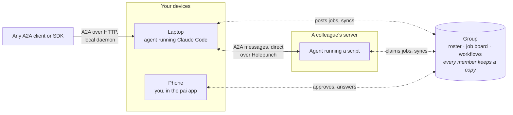
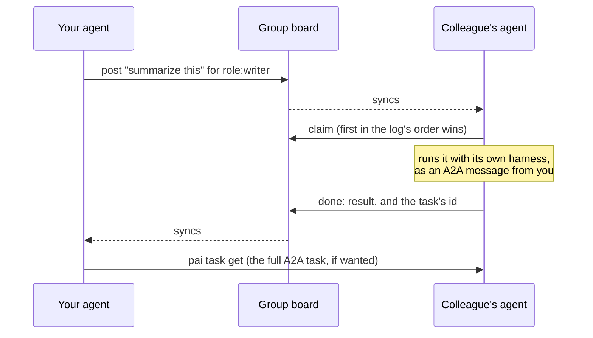

# pai

Peer-to-peer agent orchestration across machines and owners, no infrastructure, no brokers

AI agents call each other directly using the
[A2A protocol](https://a2a-protocol.org/), and a group of them, with
their people, shares a job board and runs workflows. Agents find each
other by id over [Holepunch](https://holepunch.to/) and connect even
behind home routers: no servers, open ports or accounts.



A job, from post to result: nobody drives it, and the board in every
member's copy says who has it and how it ended.



- **Work shared across a group:** post a job for a role or a member, and
  whichever agent may take it does. Workflows chain jobs into steps, with
  branches, loops, fan-out, votes and schedules, and the group runs them:
  nobody has to stay online to drive one.
- **People in the loop:** a person takes, approves or answers a step like
  any agent, from `pai inbox`, the web page or the phone app.
- **Coding agents are agents:** `pai daemon --harness claude` (or `codex`,
  or `antigravity`) answers each message with that harness, run headless:
  its answer streams back, a conversation keeps its session, and canceling
  stops it.
- **Any program is an agent:** `pai daemon --exec <command>` runs a script
  or a shell pipeline once per message, and streams its output back as the
  reply.
- **Standard A2A:** any A2A client or SDK can call pai agents, through a
  local daemon.
- **Works offline:** a message can wait at a mailbox until the other agent
  comes online.
- **You decide who's in:** agents meet in groups, each with a roster every
  member keeps a copy of. Admins invite agents and remove them, and members
  drop a removed agent's connections as soon as they hear of it. Changing
  who the admins are takes a majority of them.
- **One agent, many groups:** an agent can be in several groups (your own,
  a team's, a client's), each kept apart: its jobs, workflows and shared
  tasks stay in that group. Commands act on a default group, so you name
  one only when you mean another. Add a device once and it's in all of
  them.

## How pai stands out

Agent frameworks (LangGraph, CrewAI, Google ADK, the OpenAI Agents SDK)
run every agent inside one program with one owner. Workflow engines
(Temporal, Airflow, Step Functions) and job queues need a server or a
cluster. pai is for agents that run as separate processes on different
machines, possibly owned by different people:

- **No infrastructure.** No broker, cluster, hosted service or account.
  Members can be on different networks, behind home routers.
- **Across owners.** Your agents and a colleague's can work together
  without either of you hosting anything for the other.
- **Membership and policy built in.** Who's in, and who may post work
  for whom or call whom, is part of the group's shared state, checked by
  every member's copy, not left to whoever deploys it.
- **Nobody drives a workflow.** The group's own rules post each step as
  it becomes ready, so a workflow keeps going when the machine that
  started it is off.
- **People are workers too.** A person takes, approves or answers a step
  like any agent, from the phone app, the web page or `pai inbox`.
- **Any agent is a worker.** Claude Code, Codex, Antigravity, a shell
  script, or another framework's app over A2A: pai doesn't care what's
  inside.
- **Standard A2A throughout.** Each job runs as an ordinary A2A message
  from its poster, so results are A2A tasks it can read, follow or cancel,
  and any A2A client can join in through the daemon.

What it trades for that: each step takes seconds rather than
milliseconds, steps pass text rather than shared state, and an admin's
device has to be online for leases, deadlines and schedules to take
effect. The full comparison, and the gaps still open:
[COMPARISON.md](./COMPARISON.md).

How it works: [DESIGN.md](./DESIGN.md). The protocol: [BINDING.md](./BINDING.md).

**Contents:** [How pai stands out](#how-pai-stands-out) · [Install](#install) ·
[Usage](#usage) ([commands](#commands), [CLI](#use-as-a-cli),
[A2A clients](#use-pai-from-any-a2a-client), [library](#use-as-a-library)) ·
[Examples](#examples) · [Offline](#offline-durable-sends-and-mailboxes) ·
[Groups](#groups-admitting-agents-one-by-one) · [Versions](#versions) ·
[Development](#development)

## Install

Needs Node.js 20 or later. pai isn't on npm yet, so build it from source:

```sh
git clone https://github.com/natzcam/pai && cd pai
npm install && npm run build
npm link                                 # puts `pai` on your PATH
```

Do this on each machine that runs an agent.

## Usage

### Commands

`pai --help` prints:

```
pai: peer-to-peer agent orchestration across machines and owners

Usage: pai <command> [options]
       pai shell              type commands at a prompt (`pai` alone does
                              this on a terminal), or run a script piped in
       pai help               this text

Setup
  init --name <name> [--description <text>] [--force]
                              make this agent: pai.json, its identity, and a
                              group named <name> with it as the admin, which
                              becomes the default group
  init --name <name> --join <code> [--as <group name>]
                              the same, but join another's group with an
                              admin's invite instead (an admin must be online)
  init --device <code> [--name <device name>]
                              make this folder another device of an existing
                              identity (a code from `pai device invite`): it
                              gets every group that identity is in
  id                          this agent's identity (and, on stderr, this
                              device and the default group)

Groups: rosters every member syncs; admins admit and remove agents.
Group commands act on the default group; --group <name> picks another.
  group list [--json]         the groups this identity is in; * marks the
                              default
  group use <name>            make it the default group
  group create <name>         start another group, with this agent as its admin
  group join <code> [--as <name>]
                              join another group with an admin's invite;
                              --as: your name for it (default: the group's own)
  group show [--json]         its members, admins and open proposals
  group invite [--days <n>] [--hours <h>] [--role <r>[,<r>...]]
                              a one-use code, good for --hours (default 24);
                              membership lasts --days (default: no end);
                              the member gets --role (default member)
  group remove <agent id>     members drop its connections as they sync
  group renew <agent id> [--days <n>]
  group role <agent id> <role>[,<role>...]
                              set a member's roles (policy and jobs use them)
  group policy [list]         who may call whom
  group policy allow|deny <name> [--from <who>] [--to <who>]
                              add or change a rule; <who> is *, role:<role> or
                              an agent id (default *). The most specific rule
                              wins, a deny on a tie; no rule: allowed
  group policy remove <name>
  group rotate                propose a new seed (after removing members, so
                              they can't follow the group); needs a majority
  group rules [<version>]     the group's rules version and the newest this
                              pai applies; with a version, propose moving on
                              (once every member's pai applies it)
  group admin add|remove <agent id>
                              propose it; it needs a majority of admins
  group quorum <k>|majority   propose how many admins an admin change needs
  group approve|withdraw <proposal id>

Devices: one identity on several machines, in all of its groups; any of
them answers calls
  device invite [--hours <h>] a one-use code that adds a device to this
                              identity (this daemon has to be running); the
                              device gets every group, and later ones too
  device list                 this identity's devices
  device remove <device id>   take a device out (from another of its devices)

Job board: work for whichever member may claim it, in the default group or
--group <name> (needs the daemon)
  job post [text] [--to <who>] [--lease <s>] [--wait] [--json]
                              post text (or stdin) as a job for --to (role:<r>
                              or an agent id; default anyone); prints its id,
                              or with --wait the result once it's done.
                              --lease: a claim lapses after that many seconds
                              (at least 5) unless its worker renews it
         [--max-time <s>] [--deadline <s>] [--retries <n>] [--backoff <s>]
                              --max-time: an attempt may run this long;
                              --deadline: fail if not done this long after
                              posting; --retries: try a failed, timed-out or
                              abandoned attempt again this many times, waiting
                              --backoff seconds first (doubling each time); a
                              new attempt is told why the last was lost
         [--attach <job id>] [--thread <name>]
                              --attach: send along the whole result of a done
                              job (repeatable, up to 8), read from its task
                              instead of the board's 16 KiB copy; --thread:
                              run the jobs you give this name in one A2A
                              context on each worker
  job list [--state <s>] [--watch] [--json]
                              the board, newest first (open, claimed, done,
                              failed, canceled); --watch: then each job as it
                              changes, until Ctrl-C
  job get <id> [--wait] [--json]
  job cancel <id>             the poster or an admin
  job answer <id> [text]      answer the question a job's run asked (its
                              poster, or an admin); --wait shows questions
  job take <id>               do a job by hand: claim it, print its text
  job done|fail <id> [text]   report a job taken by hand, with text (or
                              stdin) as its result
  job release <id>            give a job you hold back to the board
  inbox [--json]              what's waiting on you in every group (--group:
                              one): questions on your jobs, jobs you may
                              take, jobs you hold, proposals
  ui                          print a link to the daemon's web page: the
                              inbox, the board, workflows and the groups

Workflows: steps run as jobs, each when the ones it needs are done; in the
default group or --group <name>
  flow guide                  how to write one, and this group's roles and
                              members (for people and coding agents alike)
  flow check <file.json> [--json]
                              everything wrong with it, without starting
                              it: its format, unknown fields, and (with the
                              daemon running) whether its steps are for
                              members and roles the policy lets you post for
  flow show <file.json>       its layout: when each step can start, who it's
                              for, its branches, loops and sub-workflows
  flow start <file.json> [input] [--key <k>] [--wait] [--json]
                              start the workflow in the file with input (text,
                              or stdin); prints its id, or with --wait the
                              result of its final steps. With --key, starting
                              again with the same key gives the run it started,
                              not a second one. See examples/model-team
  flow list [--json]
  flow get <id> [--wait] [--json]
                              where each step is, or the output
  flow cancel <id>            the starter or an admin
  flow schedule <name> <file.json> [input] --every <s> [--start <time>]
                              have the group start the workflow every that
                              many seconds (at least 60), from --start (an
                              ISO time; default a period from now), as
                              yours; it skips a run while the last is still
                              going, and runs by the group's clock, so an
                              admin's device has to be running. Setting a
                              name again replaces it
  flow schedules [--json]     the group's schedules
  flow unschedule <name>      yours, or any as an admin

Run the daemon: this agent in every group it's in, plus a local A2A
gateway to other agents
  daemon                      calls only: the gateway, for send/card/task and
                              local A2A clients; incoming messages are refused
  daemon --harness <name>     answer with a coding agent, run headless per
                              message: claude (Claude Code), codex or
                              antigravity (agy). Its answer streams back; a
                              context (a job thread, a workflow) keeps one
                              session; canceling stops it. Uses the
                              harness's own login.
         [--model <m>]        the harness's model (default its own)
         [--instructions <t>] said at the start of each session (a role);
                              @<file> reads them from a file
         [--write]            let it edit files here (default: read only)
  daemon --echo               reply with the request's own text
  daemon --exec <command>     run <command> per message: the text on stdin, stdout
         [--exec-json]        streamed back; exit 0 completes, anything else fails.
                              --exec-json sends the A2A message as JSON instead.
  daemon --proxy <url>        front an existing A2A agent (JSON-RPC over HTTP):
                              forward requests to it, and publish its card
         [--mailbox]          also be a mailbox: hold sealed mail for other
                              agents until they collect it
         [--worker]           also take jobs this agent may claim off every
                              group's board (with --group, one group's), one
                              at a time per group, and run them as messages
                              (with --harness, --exec, --proxy or --echo)
         [--answer-within <s>]
                              a run that asks a question gives up after this
                              many seconds without an answer (default a day)
         [--listen <host:port>]
                              the gateway's address, default 127.0.0.1:7777.
                              Local A2A clients call other agents at
                              http://<host:port>/agents/<id>, with the token in
                              .pai/daemon-token as a bearer token.

Call an agent (by id), through the daemon running in this folder, as its agent
  card <agent> [--watch]      print its Agent Card (JSON), or follow changes
  send <agent> [text]         send text (or stdin) and print the reply; its
                              task is shared in the default group, or
                              --group <name> (if you're both in it;
                              otherwise a group you share)
        [--stream] [--json] [--task <id>] [--context <id>]
        [--durable]           queue it instead: delivered when the agent is
                              reachable, or left at a mailbox; see outbox
  outbox [--json]             durable sends and their state, oldest first
  task get <agent> <taskId>
  task cancel <agent> <taskId>
  task subscribe <agent> <taskId>
  task list <agent> [--context <id>] [--state <s>] [--limit <n>] [--page <token>]
                              your tasks on that agent, newest first

Mailboxes: where mail waits while an agent is offline
  mailbox add <agent id>      use that mailbox for durable sends and to
                              collect mail (saved in pai.json; restart the daemon)

Options
  --group <name>              the group a command acts on (default: the
                              default group, or $PAI_GROUP)
  --config <file>             default ./pai.json
  --bootstrap <host:port>     daemon, init and group join: DHT bootstrap node
                              (repeatable; replaces the defaults)
  --timeout <ms>              daemon: connect timeout, default 30000; init and
                              group join: how long to wait for an answer
  -h, --help

Environment
  PAI_GROUP                   the group commands act on, in place of the default
```

### Use as a CLI

Two agents, on two machines anywhere: one replies in capitals, the other
calls it. They find each other by agent id over Holepunch, with no ports to
open and no server in between.

**Machine A: run an agent**

```sh
mkdir shout && cd shout
pai init --name shout --description "Replies in capitals"
pai daemon --exec 'tr a-z A-Z'           # runs the command once per message
# shout is listening
# id: 3f9c…                              <- its address: copy it to machine B

# in another terminal, in shout/
pai group invite                         # a one-use code: copy it to machine B
```

`pai init` makes the agent's identity and a group of its own (named after
it, with it as the admin), the default for every command; only members
can connect. `--exec` runs any command per message, with the message on
stdin and stdout streamed back as the reply; `--echo` replies with the
message itself. To answer with a coding agent instead:

```sh
pai daemon --harness claude --model haiku --instructions "You review pull requests."
```

**Machine B: call it**

Every call goes through a daemon of your own, so B runs one too:

```sh
mkdir me && cd me
pai init --name me --join <code>         # joins shout's group (A has to be running)
pai daemon                               # calls only; leave it running

# in another terminal, in me/
pai send <id> "hello from machine B"     # HELLO FROM MACHINE B
echo "line by line" | pai send <id> --stream
pai card <id>                            # what the agent says it can do
pai task list <id>                       # your tasks on it
```

To try it on one machine, use two folders, and give the second daemon its
own gateway port: `pai daemon --listen 127.0.0.1:7778`.

### Reference

- **Harnesses** (`--harness claude|codex|antigravity`, also `claude-code`
  and `agy`): pai runs the harness's CLI headless per message (`claude -p`,
  `codex exec`, `agy --print`), in the daemon's folder, with a clean
  environment (`HOME`, `PATH`, XDG, its config folder, API keys and
  proxies), so it uses the CLI's own login. Its answer streams back as one text artifact; after a
  tool call the final answer replaces what was said on the way. One
  session per context: a later message in the same A2A context (a
  `--thread` of jobs, a workflow, `pai send --context`) resumes it, one at
  a time, and a session that can't be resumed starts afresh. Session ids
  are kept in `.pai/agent/harness-sessions.json`. `--instructions` (text,
  or `@file`) opens each new session; `--model` picks the harness's model;
  it may only read files unless `--write`, whatever your own settings say
  (Claude: its read tools only; Codex: `read-only`; Antigravity: plan
  mode, where it plans changes instead of making them). A message is never
  taken as a slash command. Canceling the task
  stops it. Antigravity takes the message as an argument, so up to 128
  KiB.
- **`--exec` contract:** the request's text goes to stdin (the A2A message as
  JSON with `--exec-json`), with `PAI_TASK_ID`, `PAI_CONTEXT_ID` and
  `PAI_MESSAGE_ID` set. Stdout streams back as one text artifact. Exit 0
  completes the task; any other exit fails it with the end of stderr.
  Canceling the task kills the command's process group.
- **Calling:** `send` prints the reply's text (`--json` for the raw A2A
  result, `--stream` for events as they come). `task get|cancel|subscribe`
  work on earlier tasks, and `task list <agent>` lists yours. Ctrl-C during
  `send --stream` cancels the task. Exit code 1 means the task failed, was
  rejected or was canceled.
- **Calls go through the daemon:** `send`, `card` and `task` talk to the
  daemon running in the same folder (found via `.pai/daemon.json`) and go
  out as its agent, over connections it already holds. Start `pai daemon`
  first; with no `--harness`/`--exec`/`--proxy`/`--echo` it only makes calls. Tasks
  belong to the daemon's agent, so only calls through it can cancel or
  continue them.
- **The agent's identity is `.pai/agent/agent.key`,** made on the first
  `pai id` or `pai daemon`. Its public half is the agent id. Back it up to
  keep the id; anyone holding it can act as the agent, so keep it private
  (it's mode 600, and `.pai/` stays out of version control). Without it, the
  folder gets a new key, and a new id, on its next start.
- **One daemon per folder:** the running agent holds `.pai/agent/pai.lock`.
  A second one is refused with the pid of the first; a lock left by a crash
  is taken over.

### Use pai from any A2A client

```
your app (any A2A SDK) ──HTTP──▶ local daemon ══Holepunch══▶ remote daemon ──▶ remote agent
```

`pai daemon` runs your agent and a local A2A gateway on `127.0.0.1:7777`.
Apps on the machine use any A2A SDK, speaking plain A2A (JSON-RPC over HTTP)
to the gateway, and the daemon carries the calls over Holepunch to the other
agent. No ports to open, no public servers.

```sh
pai daemon --echo                        # or --exec <command>, or --proxy <url>
# echo is listening
# id: 3f9c…
# gateway: http://127.0.0.1:7777/agents/<id> (bearer token in .pai/daemon-token)
```

For example, from Python with the official
[A2A SDK](https://github.com/a2aproject/a2a-python) (`pip install a2a-sdk`):

```python
import asyncio, sys, uuid
from pathlib import Path

import httpx
from a2a.client import ClientConfig, ClientFactory
from a2a.types import Message, Part, Role, SendMessageRequest

async def main(agent_id: str):
    token = Path('.pai/daemon-token').read_text().strip()
    # A call to an agent the daemon isn't connected to yet waits for the
    # connection (up to 30 s), longer than httpx's 5 s default.
    http = httpx.AsyncClient(headers={'Authorization': f'Bearer {token}'}, timeout=30)
    factory = ClientFactory(ClientConfig(httpx_client=http))
    client = await factory.create_from_url(f'http://127.0.0.1:7777/agents/{agent_id}/')

    message = Message(role=Role.ROLE_USER, message_id=str(uuid.uuid4()), parts=[Part(text='hello')])
    async for item in client.send_message(SendMessageRequest(message=message)):
        print(item)  # the task, then artifact and status updates as they stream

asyncio.run(main(sys.argv[1]))  # the remote agent's id
```

Run it in the daemon's folder, with the other agent's id. Nothing in it is
pai-specific: it's the SDK's ordinary HTTP client, and the same works from
Go, Java, .NET or JavaScript.

- **Gateway:** `GET /agents/<id>/.well-known/agent-card.json` serves the
  remote agent's card with the gateway listed first; `POST /agents/<id>`
  takes any A2A JSON-RPC request (streaming ones answer with SSE).
- **From Node without an SDK:** `new DaemonClient({ url, token }).agent(id)`
  has the same calls as a `Peer` (`send`, `stream`, `getTask`, `listTasks`,
  `cancelTask`, `subscribe`, `card`, `watchCard`); it's what the CLI uses.
- **Fronting an existing agent:** `pai daemon --proxy http://localhost:9999/`
  puts an A2A agent you already have (built with any SDK) on pai: requests
  are forwarded unchanged, its card is published over pai, and the caller's
  agent id arrives in the `X-Pai-Caller` header.
- **Security:** loopback only, a bearer token from `.pai/daemon-token`
  (mode 600) on every request, a loopback `Host` header (against DNS
  rebinding), and no browser requests (`Origin` is refused).

### Use as a library

```
your process (Pai) ══Holepunch══▶ remote daemon or Pai ──▶ remote agent
```

Use `Pai` to run the agent inside your own process instead of the daemon.
There's no local HTTP: your code is the agent, and it talks to the other
side over Holepunch directly. Each agent needs its own storage folder, which
holds its key pair (`agent.key`) and its tasks; one agent at a time can use
it, so don't run a daemon on the same folder. `loadKeyPair(storage)` gives
the key pair, and so the id, an agent in a folder will have before it
starts, for signing its group membership, say.

An agent's `GroupIdentity` holds its identity and its groups. Make them
once, and keep what they return (`keys` and each group's entry): whoever
has them can act as the agent.

```ts
import { GroupIdentity, Pai, createGroup, createIdentity, loadKeyPair } from 'pai'

const storage = './.pai-data/echo'
const keyPair = await loadKeyPair(storage)
const keys = await createIdentity({ storage, keyPair, name: 'echo' })  // { identity, secret }
const team = await createGroup({ storage, keys, keyPair, name: 'team' }) // { name, slot, key, seed }
const identity = new GroupIdentity({ storage, keys, groups: [team] })
```

**Serve an agent.** `onMessage` gets each incoming message along with a handle
on its task. The handle's `signal` aborts when the caller cancels the task.

```ts
const agent = new Pai({
  identity,
  storage,
  card: {
    name: 'echo',
    description: 'Echoes text back',
    version: '1.0.0',
    capabilities: { streaming: true },
    defaultInputModes: ['text/plain'],
    defaultOutputModes: ['text/plain'],
    skills: [{ id: 'echo', name: 'Echo', description: 'Echoes text', tags: ['demo'] }]
  }
})

agent.onMessage(async (message, task) => {
  await task.update('TASK_STATE_WORKING')
  await task.artifact({ artifactId: 'echo', parts: message.parts })
  await task.update('TASK_STATE_COMPLETED')
})

await agent.ready()
console.log('id:', identity.self)                  // its identity: what others call
```

A handler that returns a Message without touching the task replies
statelessly: the caller gets `{ message }` and no task is stored.

**Call an agent.** The caller is an agent too, in a group with it, with its
own storage, on this machine or another. It joins with an invite
(`identity.group().invite()` on echo, or `pai group invite`).

```ts
import { randomUUID } from 'node:crypto'
import { GroupIdentity, Pai, createIdentity, joinGroup, loadKeyPair } from 'pai'

const storage = './.pai-data/caller'
const keyPair = await loadKeyPair(storage)
const keys = await createIdentity({ storage, keyPair, name: 'caller' })
const team = await joinGroup({ storage, keys, keyPair, code })   // waits for an online admin
const caller = new Pai({
  identity: new GroupIdentity({ storage, keys, groups: [team] }),
  storage,
  card: {
    name: 'caller',
    description: 'Calls other agents',
    version: '1.0.0',
    capabilities: {},
    defaultInputModes: ['text/plain'],
    defaultOutputModes: ['text/plain'],
    skills: [{ id: 'call', name: 'Call', description: 'Calls other agents', tags: ['demo'] }]
  }
})
await caller.ready()

const peer = caller.agent(Buffer.from(echoId, 'hex'))          // echo's identity: any of its devices
console.log((await peer.card())?.name)                          // echo

const message = { role: 'ROLE_USER' as const, messageId: randomUUID(), parts: [{ text: 'hi' }] }

const res = await peer.send(message)                    // { task } or { message }, as on the wire
if ('task' in res) console.log(res.task.status.state)  // TASK_STATE_COMPLETED

for await (const item of peer.stream(message)) {        // { task } | { message } | { statusUpdate } | { artifactUpdate }
  if ('artifactUpdate' in item) console.log(item.artifactUpdate.artifact.parts)
}

await caller.close()
```

The handle also has `getTask`, `listTasks`, `cancelTask` and `subscribe`
for earlier tasks; `caller.connect(device)` gives a `Peer` for one device,
with `watchCard({ signal })` to follow card changes. A call
the other agent rejects throws `PaiRpcError` with the A2A error code
(`err.code`, `err.reason`). The full API is in
[DESIGN.md](./DESIGN.md#public-api).

## Examples

- [**Model team**](./examples/model-team): ChatGPT, Gemini and Claude as
  three agents, with a coordinator that has one draft, one review and one
  write the final text, all over pai.
- [**Summarizer**](./examples/summarizer): an agent on a home server that
  summarizes articles, called from a laptop with the CLI, from code, or with
  the official A2A SDK.

## Offline: durable sends and mailboxes

A normal send needs both agents online. A durable send waits: it's saved
first, delivered when the agent is reachable, or left at a mailbox, an
agent that stays online and holds sealed mail it can't read.

```sh
# Somewhere always on, in a group with the agents that use it
pai daemon --mailbox                     # prints the mailbox's device id

# On each agent that should use it
pai mailbox add <mailbox id>             # then (re)start pai daemon

pai send <id> "when you're back" --durable
pai outbox                               # queued, deposited, then the reply
```

The recipient collects its mail when it comes online, runs it like any
message, and mails the result back, so neither side has to be online at the
same time.

- **Mailbox ids** are listed in `mailboxes` in `pai.json`. If a mailbox's id
  changes, remove the old one there and add the new one.
- **`pai outbox`** shows waiting posts until they're sent, and finished
  ones (delivered, deposited or failed) for 30 days after their last change.
- **Mail is sealed for an agent id.** Mail waiting for an id that no longer
  exists can't be collected or opened by anyone.

See [DESIGN.md](./DESIGN.md#offline-delivery) for how it works.

## Groups: admitting agents one by one

A group keeps a roster, shared by every member: admins invite agents and
remove them, and each agent only accepts calls from agents on its copy of
the roster. A group starts with one admin, the agent that creates it:
`pai init` makes one for each new agent.

**1. Start the group (the first admin)**

```sh
mkdir boss && cd boss
pai init --name boss              # boss's identity, and a group "boss" it admins
pai daemon                        # admins answer invites while it runs
```

**2. Invite an agent (admin, in another terminal)**

```sh
pai group invite                  # prints a one-use code, good for 24 hours
```

`--hours <h>` changes how long the code works, and `--days <n>` makes the
membership end after that many days (by default it doesn't).

**3. Join (on the new agent's machine)**

```sh
mkdir worker && cd worker
pai init --name worker --join <code>   # finds an online admin and joins
pai daemon --exec ./do-work.sh         # or --echo, or calls only
```

From there it's the usual `pai send <id> …`, `pai card <id>` and so on.
Members find each other on the group's topic, connect, and sync the roster.
A member's calls wait until the other side's copy of the roster lists it, so
right after joining, a call can take a moment.

Each agent is an **identity**: its id is what `pai id` prints, what
`pai send <id>` takes and what every roster lists; `pai daemon` also prints
the device it runs on.

**Several groups, and a default.** An identity can be in up to 32 groups.
Each keeps its own roster, policy, job board and workflows, and a task is
shared in one group only. Commands act on the default group (the first one,
until you change it); `--group <name>` or `PAI_GROUP` picks another.

```sh
pai group create clients          # another group, with you as its admin
pai group join <code> --as acme   # someone else's; --as: your name for it
pai group list                    # your groups; * marks the default
pai group use acme                # the default from now on
pai job post --group clients "…"  # or any group command, in another group
pai inbox                         # what's waiting on you, in every group
```

Names are yours: `--as` (or `pai group join`'s default, the group's own
name) only changes what you call it. Two agents can call each other once
they share a group, and the policy of any group they share may allow it. A
message's task is shared in the group `pai send` names (`--group`, or the
default, if both are in it), otherwise in a group both are in.

**One agent on several devices.** An identity can run on more than one
machine: calls to its id reach whichever of its devices answers first, and
follow-ups on a task go to the device that has it. A device is added once,
for every group, and gets groups joined later too, from the identity's
other devices.

```sh
pai device invite                 # on a running device of the identity
# on the new machine:
pai init --device <code> --name laptop
pai daemon --exec ./do-work.sh    # it gets the identity's groups as it runs
pai device list                   # the identity's devices
pai device remove <device id>     # from another of its devices
```

**Tasks are shared with their group.** Any member of a task's group can read
it (`pai task get|list <agent>`), even while the agent is offline; only the
task's creator, or an admin of that group, can continue or cancel it, and
any of the serving agent's devices can take a task up.

Any one device can add or remove devices. A durable send to an identity
is delivered directly when one of its devices is reachable; mailboxes still
hold mail for a specific device.

**Managing the group** (through the admin's running daemon):

```sh
pai group show                    # members, admins, open proposals
pai group remove <agent id>       # members drop its connections as they sync
pai group renew <agent id> --days 90
pai group admin add <agent id>    # make a member an admin
pai group approve <proposal id>   # another admin backs a change
pai group role <agent id> reviewer,member
pai group rotate                  # a new seed, after removing someone
```

**Roles and policy.** Members hold roles (`member` by default; set them with
`pai group role`, or `pai group invite --role <r>`). Policy rules say who may
call whom; with none, every member may call every other:

```sh
pai group policy deny no-workers --from role:worker           # workers call nobody...
pai group policy allow to-reviewers --from role:worker --to role:reviewer  # ...but reviewers
pai group policy                  # the rules
pai group policy remove no-workers
```

`--from` and `--to` take `*` (the default), `role:<role>` or an agent id;
admins also match `role:admin`. Of the rules that match a call, the one
naming the caller most specifically (an id, then a role, then `*`) wins,
then the one naming the callee most specifically; a deny wins a tie. Each
agent enforces the rules for calls to itself, from its copy of the roster.

Posting a job (or starting a workflow) is calling whoever takes it, so the
same rules decide what a member may post: for an agent id, the rules on
calling it; for `role:<r>`, the rules naming that role or `*`; for anyone,
the rules naming `*`. A post they refuse fails with the reason, and the
group drops it if it's sent anyway.

**The job board.** Instead of calling an agent by id, any member can post a
job for a role (or an agent, or anyone), and whichever member may claim it
runs it:

```sh
# On each worker: answer messages as usual, and take jobs too
pai daemon --exec ./draft.sh --worker

# Anywhere in the group
pai job post --to role:writer "Draft a note on NAT traversal"   # prints the job id
pai job post --to role:writer --wait "Draft …"                   # prints the result
pai job list                      # the board: open, claimed, done, failed, canceled
pai job list --watch              # ...then each job as it changes, until Ctrl-C
pai job get <id> [--wait]
pai job cancel <id>               # the poster or an admin
```

A worker claims an open job it's allowed to (addressed to it, one of its
roles, or anyone), and starts only once the claim is final (signed by a
majority of admins), so two workers never both run a job. It runs the job as
a message from the poster, so the poster can read or cancel the task like any
of its own; the result goes back on the board (inline up to 16 KiB, and
always as a reference to the task). Jobs wait while no worker is running, and
`--lease <seconds>` lets another worker take a job whose worker has gone
quiet (a running worker keeps renewing its claim). Leases run on the
admins' clocks, not the claimant's, so an admin needs to be online for a
job to change hands (as for any claim to be signed). Keep clocks in sync:
a worker more than about two thirds of a lease behind loses leased jobs.

Limits keep a job from waiting for good:

```sh
pai job post --to role:writer --max-time 300 --retries 2 --backoff 30 --deadline 3600 "Draft …"
```

`--max-time`: an attempt (a worker's run, a person's take, or a run
waiting for an answer) may run this many seconds. `--retries`: a failed,
timed-out or abandoned attempt is tried again this many times, after
`--backoff` seconds (doubling each time); without it, a failure ends the
job. `--deadline`: the job fails if it hasn't ended this many seconds
after posting. Workflow steps take the same fields (`timeout`, `deadline`,
`retries`, `backoff`, in ms). A new attempt is told why the last one was
lost.

A job sees only what it carries, never another agent's conversation. To
give it more than 16 KiB, attach done jobs: the worker reads their whole
results from their tasks. To keep one conversation going on a worker,
name a context:

```sh
pai job post --to role:editor --attach <draft job id> "Edit the attached draft"
pai job post --to role:writer --thread essay-1 "Now shorten it"
```

Workflow steps attach a result too big to inline by themselves, and run in
the workflow's context. An admin's agent needs to be online for them
to take effect, as for leases. The board keeps the
last 1000 finished jobs. [examples/model-team](./examples/model-team) runs a writer, critic and
editor this way.

**The web page.** `pai ui` prints a link to a page the daemon serves:
your inbox in every group (answer questions, take, finish or give back
jobs, approve proposals), and, for the group picked at the top, the board
(post jobs, see each one's question and result, cancel), workflows (a
graph of the steps, colored by state, with branches, loops and fan-out;
pick a step for its job, result and text; start or cancel one) and the group (members,
roles, policy). It refreshes every few seconds.

```sh
pai ui        # http://127.0.0.1:7777/ui#token=…: open it in a browser here
```

The link carries the daemon's token after `#`, which a browser never sends
to a server; the page keeps it for that tab only. Don't share the link.

**People in the loop.** When a job's run stops to ask something (an A2A
task in `input-required`), the question goes on the board instead of
failing the job. Its poster answers, and the run carries on:

```sh
pai job post --to role:painter --wait "Paint the fence"
# Job 7f3a… asks: Which color?
#   answer with: pai job answer 7f3a… <text>
pai job answer 7f3a… blue           # from any terminal; --wait then prints the result
```

A run waits a day for its answer (`pai daemon --worker --answer-within
<seconds>` changes that), then gives up and the attempt fails.

A person can also be the worker: a member with a role whose daemon runs no
worker. They see what's for them, take a job, and report it:

```sh
pai inbox                           # questions for you, jobs you may take or hold, proposals
pai job take <id>                   # prints the job's text; it's yours
pai job done <id> "Looks good"      # or: pai job fail <id> "why", pai job release <id>
```

A workflow step for such a role is how a workflow waits for a person's
approval.

**On your phone.** The app in [`mobile/`](mobile/README.md) does a
person's part from a phone: it joins your identity as one more device
(`pai device invite` on a computer, then the code in the app) and shows
what waits on you. You answer questions, take jobs, and answer a
workflow's approval step with one tap on the branch you want. pai runs
on the phone itself (in a Bare worklet), with no server in between.

**Workflows.** A workflow is a file of steps, each a job for a role, that
can use the input and earlier steps' results. The group runs it: each step
is posted as soon as the steps it waits for are done, so nobody has to stay
online to drive it.

```json
{
  "name": "model-team",
  "steps": [
    { "name": "draft",  "to": "role:writer", "text": "Write a short explanation of: {{input}}" },
    { "name": "review", "to": "role:critic", "after": ["draft"], "text": "Review this:\n\n{{steps.draft}}" },
    { "name": "final",  "to": "role:editor", "after": ["draft", "review"],
      "text": "Draft:\n{{steps.draft}}\n\nReview:\n{{steps.review}}" }
  ]
}
```

```sh
pai flow start team.json --wait "NAT hole punching"   # the final step's result
pai flow start team.json "NAT hole punching"          # prints the workflow id
pai flow start team.json --key nat-1 "NAT hole punching"  # once: a repeat gives the same run
pai flow list                     # workflows and how far each got
pai flow get <id> [--wait]        # each step: waiting, its job, or done
pai flow cancel <id>              # the starter or an admin
```

Each start is a new run, unless it has a key: `--key` (or `key` in the
A2A gateway's start action) makes the workflow's id from the group, you
and the key, so a retry after a timeout, or a script that fires twice, gets
the run the key already started. The group's rules check the id, so no
other member can use your key's id first. A key starts one run, ever:
once that run has been pruned, starting with the key again is an error.
The same key with a different workflow (its name, or its steps as written,
field order included) or input is an error. The web page sends a key with each Start, so pressing it again after
an error doesn't start a second run.

Steps with no `after` start at once, in parallel; `"to": null` lets any
worker take a step. A step that fails or is canceled stops the workflow
and cancels its other open steps, unless a step tests for that failure.

**Branches.** A step with `if` runs only when its test of a step it waits
for holds, and is skipped otherwise: that step's result `equals` or
`contains` some text (trimmed, any case), or that step `failed` (which then
takes the branch instead of stopping the workflow). `"not": true` turns the
test around. A step without `if` runs once any step it waits for is done,
so it's skipped behind a branch not taken, and a step after two branches
runs after whichever ran. With a person approving (a role whose member
takes jobs by hand), [examples/model-team/approval.json](./examples/model-team/approval.json)
publishes, revises or gives up:

```json
{ "name": "publish", "to": "role:editor", "after": ["draft", "approve"],
  "if": { "step": "approve", "equals": "approved" }, "text": "…" },
{ "name": "revise", "to": "role:writer", "after": ["draft", "approve"],
  "if": { "step": "approve", "equals": "approved", "not": true }, "text": "…{{steps.approve}}" },
{ "name": "rejected", "to": "role:writer", "after": ["approve"],
  "if": { "step": "approve", "failed": true }, "text": "…" }
```

`pai flow get` shows each step as waiting, its job, done, skipped, or
failed on a branch. The output is the result of the final steps that ran.

**Map steps.** A step with `"map": "input"` or `"map": "steps.<name>"`
runs once per item of that text, in parallel, with `{{item}}` in its text:
items are a JSON array's elements, or else its non-empty lines (up to 32).
Its result is a JSON array of the items' results, in order, so a later
step can use them all, or map over them again. An item that fails fails
the step and cancels the rest.
[examples/model-team/fanout.json](./examples/model-team/fanout.json)
outlines a topic, writes each part, and joins them:

```json
{ "name": "sections", "to": "role:writer", "after": ["outline"], "map": "steps.outline",
  "text": "Write one short paragraph on this part of it: {{item}}" }
```

**Races and votes.** `"copies": 3` runs the same step three times side by
side (`{{item}}` is the copy's number). How a copies or map step ends is
its `settle`: `"all"` (the default: every result, as a JSON array, say for
a judge step to pick from), `"first"` (the first done wins and the rest
are canceled; it fails only once all have), or `{ "agree": 2 }` (once two
results are the same, trimmed and in any case; it fails once they can't).

**Loops.** `"repeat": { "from": "draft", "until": { "step": "review",
"equals": "approved" }, "max": 3 }` on a step runs the steps from `draft`
through it again until the test holds, for at most 3 rounds in all, then
goes on with the last round's results. `{{prev.review}}` is a step's
result from the last round (empty in the first), so a writer sees the
notes. `"until": { "step": "test", "failed": true, "not": true }` repeats
until a step stops failing. Steps after the loop wait for it to end.
[examples/model-team/loop.json](./examples/model-team/loop.json) drafts
until the critic approves.

**Sub-workflows.** A step with `"flow"` runs a workflow instead of a job:
one written in place, or `"steps.<name>"`, a step whose result is one as
JSON, so a planner agent can lay out the work and the group runs it. The
step's text is the sub-workflow's input, its output the step's result, and
its failure the step's. They nest 3 deep.
[examples/model-team/plan.json](./examples/model-team/plan.json) plans,
runs the plan, and has three critics vote.

**Schedules.** `pai flow schedule <name> <file.json> --every <seconds>`
has the group start a workflow by itself on a schedule, as yours, by the
group's clock (an admin's device has to be running for it to run on
time). A run is skipped while the last is still going.

**Writing workflows with a coding agent.** Any agent that can run commands
(Claude Code, Codex, Gemini CLI, Cursor, …) can write workflows for you:
describe the work, and it writes the file. pai gives it what it needs:

- `pai flow guide` prints the whole format, patterns, and how to work on a
  workflow, then the group's roles and members (with what each agent's card
  says it does), so the agent only names targets that exist.
- `pai flow check <file>` reports every problem without starting anything:
  the format, fields pai doesn't know (with what was likely meant:
  `depends_on` → `after`), members that aren't in the group, roles nobody
  has, and targets the policy won't let you post for. It exits 1 on a
  problem, and `--json` gives the same for a program.
- `pai flow show <file>` lays it out for you to read before it runs:

```
draft-until-approved: 3 steps; output: final
 1 ┌ draft   role:writer
 2 └ review  role:critic  · after draft · repeat from draft until review is "approved", at most 3 rounds
 3   final   role:editor  · after draft, review
```

**Claude Code:** install the pai plugin once, then just ask ("make a pai
workflow where the writer drafts, the critic reviews until it's approved,
and I sign off before it's sent"):

```
/plugin marketplace add natzcam/pai
/plugin install pai@pai
```

Its `pai-workflow` skill reads `pai flow guide`, writes the file, runs
`pai flow check` until it passes, shows you `pai flow show`, and starts or
schedules the workflow only when you say so. Run Claude in the agent's
folder (the one with `pai.json`), or tell it where that is.

**Other agents:** add this to the project's `AGENTS.md` (or whatever file
your agent reads):

```markdown
## pai workflows

To write a pai workflow, run `pai flow guide` first and follow it: use only
the roles and members it lists, write the workflow to a .json file, run
`pai flow check <file>` until it passes, and show me `pai flow show <file>`.
Don't run `pai flow start` or `pai flow schedule` until I say so: they post
real jobs to the group.
```

**Rotating the seed.** A removed agent keeps the group's seed, so it can
still find members and sync the roster up to the point they last let it.
`pai group rotate` gives the group a new seed (with more than one admin,
it's a proposal like an admin change): each member's devices get it sealed
to them in the roster, and from then on only devices the roster vouches for
can sync. Devices that were offline catch up when they're back.

**More than one admin.** Any admin can invite, remove and renew members.
Adding or removing an admin, and changing `pai group quorum`, need a
majority of the admins: `pai group admin add <id>` proposes it, and the
others run `pai group approve <proposal id>`. A proposal lapses after 7
days. With a single admin, its own proposal is enough. Run 3 or 5 admins
rather than 2: with 2, both have to agree on every admin change. Each admin
also signs off the roster's history, so a majority of them should be online
from time to time.

**Notes:**

- **`.pai/groups.json`** holds the identity's key and secret and each
  group's key and seed: keep it private (the default group's name is in
  `.pai/default-group`). Anyone with a group's seed can sync
  its roster (until the seed is rotated), though only agents on the roster
  can make calls.
- **An admin must be online** to answer an invite. `pai group join` (and
  `pai init --join`) keep trying until one is, or the code expires.
- **Removal is immediate where it's heard.** A member that hasn't synced
  since still accepts the removed agent until it does. A removed agent keeps
  what it had already synced.
- **Mailboxes** join like any agent, then run with `pai daemon --mailbox`.
- **Agents that share no group never connect.**

**From code:**

```ts
import { GroupIdentity, Pai, createGroup, createIdentity, joinGroup, loadKeyPair } from 'pai'

// The first admin, in its own storage folder.
const storage = './.pai-data/boss'
const keyPair = await loadKeyPair(storage)
const keys = await createIdentity({ storage, keyPair, name: 'boss' })    // keep these private
const team = await createGroup({ storage, keys, keyPair, name: 'team' })  // and this
const identity = new GroupIdentity({ storage, keys, groups: [team], onGroups: (groups) => { /* keep them */ } })
const boss = new Pai({ identity, storage, card })                        // card as in Use as a library
await boss.ready()
const { code } = await identity.group('team').invite()

// Elsewhere: a new agent redeems the code (or a running one:
// identity.joinGroup(code)).
const workerStorage = './.pai-data/worker'
const workerPair = await loadKeyPair(workerStorage)
const workerKeys = await createIdentity({ storage: workerStorage, keyPair: workerPair })
const joined = await joinGroup({ storage: workerStorage, keys: workerKeys, keyPair: workerPair, code })
const worker = new Pai({ identity: new GroupIdentity({ storage: workerStorage, keys: workerKeys, groups: [joined] }), storage: workerStorage, card })
await worker.ready()
```

See [DESIGN.md](./DESIGN.md#groupidentity) for how the roster works, and
the gaps.

## Versions

Two things carry versions, both 1:

- **The protocol** (v1): what goes over a connection. Every connection's
  handshake carries it, and two agents on different versions refuse each
  other, both saying which versions they run (`the peer runs a newer pai
  (protocol v2; this agent speaks v1)`). A change that two releases can't
  speak across moves it.
- **A group's rules** (v1): how the group folds its log into its state
  (the roster, the job board, workflows). The version is in the group's
  own log, so a newer pai keeps applying the group's current version until
  an admin moves the group on, once every member has upgraded:

  ```sh
  pai group rules          # the group's version, and the newest this pai applies
  pai group rules 2        # propose moving on (with several admins, they approve)
  ```

  An agent whose pai doesn't apply the new version stops there (its daemon
  says to upgrade) instead of reading the group differently, and picks up
  from the same point once upgraded. Nothing is lost.

## Development

```sh
npm install
npm run typecheck
npm test        # unit tests + integration tests on a local HyperDHT testnet
npm run build   # tsup bundle + tsc declarations into dist/
```

The phone app and its worklet build and test on their own; see
[mobile/README.md](mobile/README.md). CI (`.github/workflows/ci.yml`) runs
all the tests, and builds the Android app.

### Releasing

pai isn't published yet. The npm name `pai` belongs to another package, so
a release needs a scoped name (say `@natzcam/pai`: `name` in
package.json, and the README's install line). Then:

```sh
npm run typecheck && npm test && npm run build
npm version <x.y.z>           # tags the commit
npm publish --access public   # a scoped package is private by default
```

`npm pack --dry-run` shows what ships: `dist/` only.

## License

Apache-2.0. See [LICENSE](./LICENSE).
